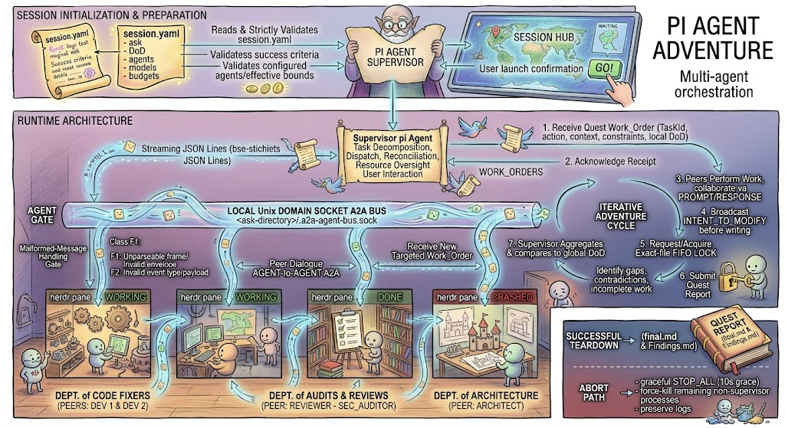
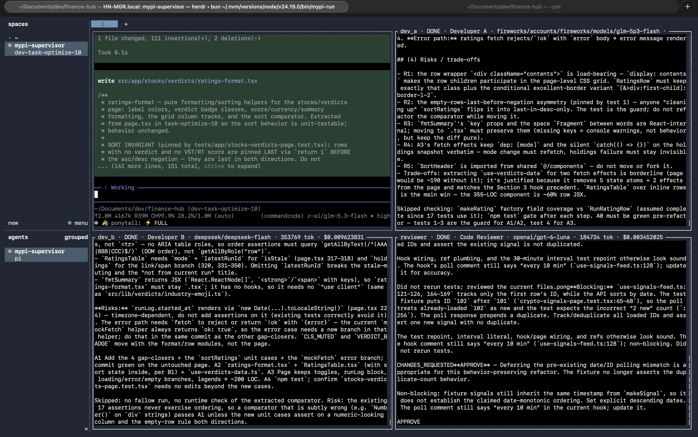

# mypy-multi-agent

Local-first multi-agent orchestration for software-engineering work, built on [pi](https://pi.dev) + [herdr](https://herdr.dev).

One interactive **supervisor** agent decomposes a task, spawns headless **peer** agents into herdr terminal panes, coordinates their work over a local agent-to-agent (A2A) message bus, and reconciles their results against a Definition of Done (DoD) before declaring the run finished.



## Why

A single-agent coding session serializes everything through one context. This project explores the alternative: a roster of specialized agents (reviewer, fixer, researcher…) working **concurrently**, each with its own model, system prompt, permissions, and budget — while a supervisor keeps the aggregate honest against an explicit DoD. Everything runs locally: no cloud orchestration. The agents run in terminal panes you can watch; finished runs are also inspectable in a read-only web viewer — see `web/README.md`.

## How it works

1. **Configure** — a declarative `session.yaml` defines the ask, the DoD, and the agent roster (model, permissions, budget per agent).
2. **Launch** — the launcher opens a dedicated herdr workspace with pi running the supervisor, which validates the config and spawns each peer as a headless pi instance in its own herdr pane.
3. **Coordinate** — peers register on a local unix-socket bus (JSONL frames with correlation IDs and heartbeats). The supervisor dispatches bounded work orders. A peer-to-peer prompt frame exists in the protocol, but it is not implemented and not planned ([ADR 0002](docs/adr/0002-peer-to-peer-prompts-deferred.md)); only the supervisor opens prompts. A peer that has settled can be reactivated by a question.
4. **Reconcile** — when peers file final reports, the supervisor decides whether the aggregate result satisfies the DoD, re-dispatching follow-ups if not.
5. **Finalize** — the run ends with `final.md` (summary + decision record + cost/token breakdown) and `findings.md` (raw per-peer reports) in the task's `run-details/`.

Implementation: TypeScript on [bun](https://bun.sh), shipped as a pi extension (`src/pi/extension.ts`). Full details: the GitHub issue tracker; `docs/multi-agent-spec-v1.6.md` is a historical product spec.

## Status

- **Implemented + tested:** config schema/validation, A2A protocol, bus framing, registration/heartbeat, correlation/retry, control plane, permissions/locking, budget accounting, reconciliation/finalization, validation gates (armed by peer `edit`/`write`), `await_response`, shell-allowlist gate, `agent_settled` capture, `tool-calls.jsonl`, persistent peer sessions, `web_fetch`, `final.md` decision record + cost breakdown + summary (unpriced models labeled; token bound excludes cache reads), `findings.md` raw reports (empty reports annotated), crash/finalize logging, model preflight (`verify_models`), mute detection (`AGENT_UNUSABLE`) and turn-stall detection (`AGENT_STALLED`, `session.stall_timeout_ms`), peer recovery (`restart_agent`, reports the peer's bound before respawn), work-order-boundary budget stops (`stop_at_work_order_boundary`), detected-analyzer briefing, guard tests for templates/in-repo doc links, architecture diagram (six renderer variants in `docs/architecture-diagram-alternatives/`).
- **Live E2E verified** (`test/e2e/e2e.test.ts`, `E2E_LIVE=1`): real herdr panes + real model, config → bus → panes → registration → work → reports → `final.md` → exit 0.

Run it: inside a herdr pane, `E2E_LIVE=1 E2E_MODEL=<provider/model> bun run test test/e2e/e2e.test.ts` (default model `deepseek/deepseek-v4-pro`). It spends real model money, and being in a pane does not enable it: peers inherit `HERDR_ENV=1`, so pane-detection would make every peer's `bun run test` nest a live run inside a live run.

## Prerequisites

- [pi](https://pi.dev)
- [herdr](https://herdr.dev)
- [bun](https://bun.sh)
- [just](https://just.systems) (optional — the launcher is `bun run start`; `just` only fronts the test/typecheck aliases)
- [biome](https://biomejs.dev) and `fallow` — used often for quality control: lint/format, dead code, duplication

Tasks may reference external tools and skills by name — `just`, `biome`, `fallow`,
`ponytail`, `excalidraw-diagram`, and others. Install what the task you run needs.
Those are the task's choices, not dependencies of this repo: a task that names no
skill needs none, and nothing here gates on one being present.

## Activate globally (one time)

Add the extension to `~/.pi/agent/settings.json` so `/mypi-multi-agent` loads in
every pi session regardless of directory:

```json
"extensions": ["/absolute/path/to/mypy-multi-agent/src/pi/extension.ts"]
```

Keep the repo at that path (it is the system's home — the extension resolves the
peer harness and supervisor prompt relative to itself).

## Do a run

1. **Log in to the providers your config uses.** Every `model:` and `supervisor_model:` slug must be resolvable. Run `/login` in pi for each provider, and check exact slugs + current deals in `../model-catalog.md`.
2. **Configure the project, then get a `session.yaml`.** Run `/mypi-multi-agent --init` once: it creates a root `mypi-multi-agent.yaml` (default `taskDirs: [mypi-tasks]`) and drops a keys-only starter at `mypi-tasks/task/session.yaml`. Fill in the starter's keys, or copy `templates/session.yaml` (master, filled values), a named template, or `templates/review-and-improve-code.yaml` into `<taskDir>/<task>/session.yaml`. The run command never creates these files for you.
3. **Start the supervisor** — opens a dedicated herdr workspace and starts pi there:

   ```sh
   mypi-run [dir]     # path-independent, after a one-time `npm link` in this repo
   bun /abs/path/to/mypy-multi-agent/src/pi/launch.ts [dir]   # no install needed
   bun run start [dir]   # only when run from inside THIS repo — bun resolves the local package.json
   ```

   `dir` defaults to the current directory. Do **not** rely on `bun run start` from
   another repo: `bun run` runs that repo's `package.json` scripts, not this one's.

   The extension is registered globally in `~/.pi/agent/settings.json`, so
   `/mypi-multi-agent` is available in every pi session regardless of directory.
   The pane closes itself when you quit pi.

4. **Launch the run** (name a task, or pass nothing to auto-resolve the first
   task under the configured taskDirs):

   ```
   /mypi-multi-agent [--resume] [name]
   ```

   **Shortcut — `just task <name>`.** One command prepares a git worktree on
   branch `task/<name>`, links `node_modules`, copies the authored `session.yaml`
   into it, starts the supervisor there, and auto-runs `/mypi-multi-agent <name>`.
   Author the config in the main checkout first (single source); the run then works
   in isolation on its own branch. `just prep <name>` sets up the worktree without
   launching.

5. **Watch the peer panes** — the one-line status (role/model/state/cost/tokens) lives in the pane title bar and the herdr sidebar; the pane body shows the live transcript. To zoom one pane full-screen, focus it and press `prefix+z` (`ctrl+b` then `z` by default), or run `herdr pane zoom <pane-id> --toggle`. Control the run:

   ```
   /stop-all           # graceful stop all peers + abort supervisor turn
   /stop <agent>       # graceful stop one peer
   /kill-all           # immediately terminate all peers + abort supervisor turn
   /finalize true      # write final.md (exit 0), stop peers, remove transient files
   /finalize false     # write final.md (exit 1), stop peers, remove transient files
   ```

6. **Result:** `final.md` (frontmatter status/exit_code + cost breakdown; body is the supervisor's decision record) and `findings.md` (the raw per-peer reports), plus `conversation.jsonl` and `tool-calls.jsonl`, in `run-details/`.

   `/finalize` also removes the transient files (`.peer-*.json` peer configs and
   the socket). On a crash/abort they are left in place for inspection.

## Where a run lives

A project declares where tasks live in a root `mypi-multi-agent.yaml` — an ordered
`taskDirs` list. The first entry is the write target (new runs land there and it wins
name collisions); later entries are read-only legacy fallbacks. `/mypi-multi-agent --init`
writes a default `taskDirs: [mypi-tasks]` config plus a starter task.

```
some-repo/
  mypi-multi-agent.yaml  # version: 1, taskDirs: [mypi-tasks]
  mypi-tasks/
    auth/                # ← task name
      session.yaml       # ask, DoD, roster, budgets
      run-details/       # plan.md, findings.*, final.md, conversation.jsonl, tool-calls.jsonl
```

The launcher opens pi at the project root. Name a task with `/mypi-multi-agent <name>`
(resolves to the first `<taskDir>/<name>/session.yaml` across taskDirs in order), or run
with no argument to auto-resolve the first task found under the configured taskDirs
(errors `multiple session.yaml` if several distinct tasks exist). A root `session.yaml`
and explicit file paths are not consulted — every lookup is a task name. A run never
creates a config, task directory, or session.yaml; if the project has no
`mypi-multi-agent.yaml`, run `/mypi-multi-agent --init` first.

## Observability

After a run finishes, a read-only web viewer renders its artifacts in the browser — see `web/README.md`.

A run is watchable at three levels:
- **Live panes** — each peer runs in a herdr pane. The one-line status (role/model/state/cost/tokens) is self-reported by the peer into the pane title bar via `herdr pane report-metadata` and also rolls up into the herdr sidebar; the pane body shows the live transcript (`herdr pane read <pane-id>`). Zoom a pane full-screen with `prefix+z` (`herdr pane zoom <pane-id> --toggle`). `model not found` and crash stderr surface here.
- **Artifacts** — every bus event, tool call, and report is persisted to the ask directory's `run-details/` subdirectory (below).
- **Budgets** — per-agent and session cost/token usage is tracked live and enforced against configured limits; totals land in `final.md`.



### Run artifacts

All artifacts land in the ask directory's `run-details/` subdirectory.
- `conversation.jsonl` — the orchestration timeline, one JSON line per event in order:
  - `AGENT_REGISTER` — a peer connected
  - `WORK_ORDER` — a task was dispatched
  - `FINAL_REPORT` — a peer finished and reported
  - `AGENT_CRASHED` — a peer died (`reason` is `heartbeat timeout` or `disconnected`)
  - `AGENT_UNUSABLE` — a peer stayed connected but produced only empty, zero-usage turns (`attempts` is the turn count)
  - `AGENT_STALLED` — a peer's open turn made no progress for `stall_timeout_ms` (notify-only; the peer is not stopped)
  - `STOP_AGENT` / `STOP_ALL` / `KILL_ALL` — lifecycle signals fired
  - `ERROR` — a malformed frame, a supervisor-model miss, or an await/send_prompt timeout (`correlation-timeout`)
  - `FINALIZED` — the run ended, with `outcome` and `exitCode`
- `tool-calls.jsonl` — peer tool executions (`read`/`edit`/`bash`/`web_fetch`), one line per call.
- `final.md` — outcome + decision: frontmatter `status`, `exit_code`, `total_cost_usd`/`total_tokens`, `supervisor_cost_usd`/`supervisor_tokens`, and per-agent `cost_usd`/`tokens`; the body has a `## Summary` (total-cost line + accomplished/left lists), then the supervisor's decision record (per-section dev_a vs dev_b tension, the reviewer's verdict, and the call made).
- `findings.md` — the raw per-peer FINAL_REPORTs (an empty report is annotated).
- `plan.md` — the supervisor's working plan (section table + todo); the briefing tells it to write this in the ask directory.
- Peer panes (`herdr pane read <pane-id>`) — live transcript; `model not found` and crash stderr show up here.
- Supervisor reasoning lives in the pi session transcript (its `dispatch_work_order` / `collect_reports` calls are not in `tool-calls.jsonl`).

### Diagnosing a stall

- No `AGENT_REGISTER` for a peer → it never connected; read that peer's pane for `model not found: <slug>`.
- `WORK_ORDER` but no `FINAL_REPORT` → still working, or it crashed mid-work (look for `AGENT_CRASHED` or `AGENT_UNUSABLE`).
- A peer's open turn makes no progress for `stall_timeout_ms` → `AGENT_STALLED` (notify-only; the peer is not stopped). A dead peer instead shows `AGENT_CRASHED` within the heartbeat timeout.
- `FINAL_REPORT`s present but no `final.md` / no `FINALIZED` line → the supervisor never ran `/finalize true|false`.

## session.yaml

One declarative config per task:

```yaml
version: "1.1"

session:
  id: "review-01"
  max_cost_usd: 5.00
  agent_stop_threshold_percent: 85
  # Optional peer model-call retry: pause 30s before each retry, up to 3 retries.
  peer_retry_pause_ms: 30000
  peer_max_retries: 3
  # Optional timeout for send_prompt/await_response (default 120000).
  peer_prompt_timeout_ms: 120000
  # Optional pre-spawn model check: strict | warn | off (default warn).
  verify_models: warn
  # Optional stall detection: emit AGENT_STALLED after this long with no turn progress (0 disables).
  stall_timeout_ms: 300000

ask:
  title: "Security review"
  description: "Review JWT auth in ./src/auth.ts"
  definition_of_done:
    - "Reconciled findings with concrete fixes"

agents:
  - id: "reviewer"
    title: "Security Reviewer"
    model: "deepseek/deepseek-v4-pro"
    permissions:
      read: true
      edit: false
      shell: false
    max_cost_usd: 1.00
    system_prompt: "You are a security reviewer."
```

A free/unpriced model requires `max_tokens` on that agent; `shell: true, edit: false` requires a `shell_allowlist`. A `read: true` peer also gets `web_fetch` (read-only web research) and keeps one persistent session for the whole run. Full contract: `docs/agent-config-guide.md`.

## Templates

- `templates/session.yaml` — master; common fields commented (`wall_clock_ms` is omitted)
- `templates/starter.yaml` — keys-only form (no values); dropped by `/mypi-multi-agent --init`
- `templates/review-and-improve-code.yaml` — two developers propose, a reviewer approves, then they implement
- `templates/pm-led-dev.yaml` — PM writes all code, 2 read-only devs, reviewer
- `templates/security-review.yaml` — read-only architect + auditor
- `templates/code-fix.yaml` — reviewer + edit-capable fixer + validation gate
- `templates/research.yaml` — read-only researcher + analyst
- `templates/spec-plan-adversarial.yaml` — frozen spec docs with diverge-and-defend rounds before the reviewer attests
- `templates/tdd-build.yaml` — test-first implementer, cross-check engineer, independent verifier, reviewer
- `templates/free-research.yaml` — read-only research on free/unpriced models; every peer needs `max_tokens`
- `templates/post-mortem.yaml` — three read-only analysts + a reviewer over completed runs; writes `run-details/findings-summary.md`
- `templates/task-optimize-8/session.yaml` — time-boxed review/optimize run with a fallow + biome inventory and a findings diagram

## Models

Exact slugs, per-provider cost, and current deals: `../model-catalog.md`.

## Launching and aliases

```sh
mypi-run [dir]                     # launch the supervisor from anywhere (after `npm link` here)
bun /abs/path/to/mypy-multi-agent/src/pi/launch.ts [dir]   # path-independent, no install
bun run start [dir]                # same, but only from inside this repo
just run                           # alias for the in-repo bootstrap
just run resume                    # the same, starting the supervisor on --resume
just test                          # vitest suite
just mutate                        # StrykerJS over the curated modules (not part of `check`)
just typecheck                     # tsc --noEmit
just peer <config>                 # debug one headless peer from a live run's .peer-<id>.json
just cleanup <dir>                 # delete gitignored run artifacts under <dir> (keeps session.yaml)
```

## Develop

Docs: spec (historical) `docs/multi-agent-spec-v1.6.md` · config guide `docs/agent-config-guide.md` · models `../model-catalog.md` · work items: GitHub issues (`gh issue list`)
