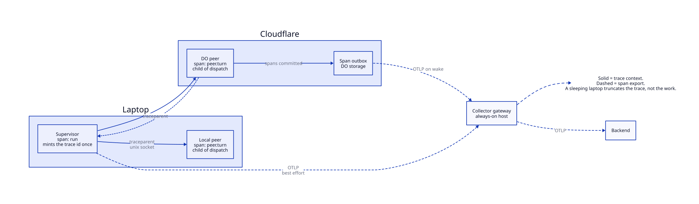
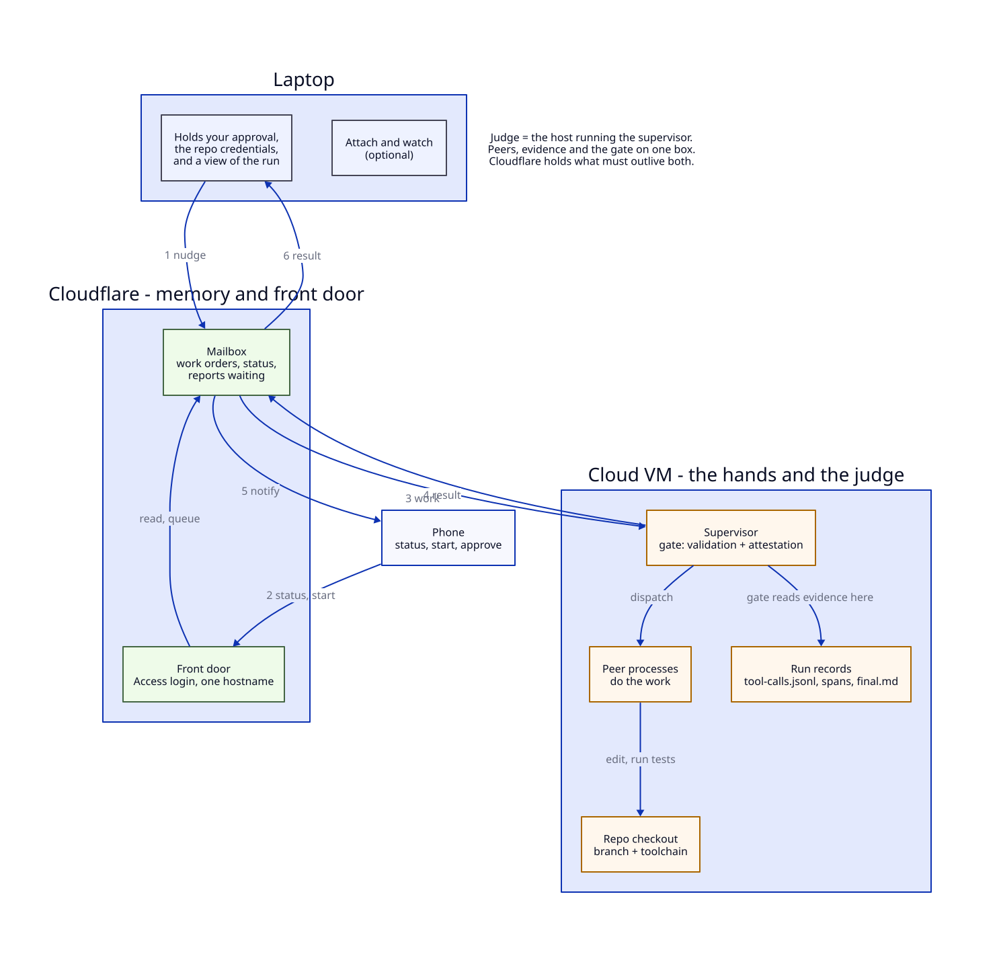
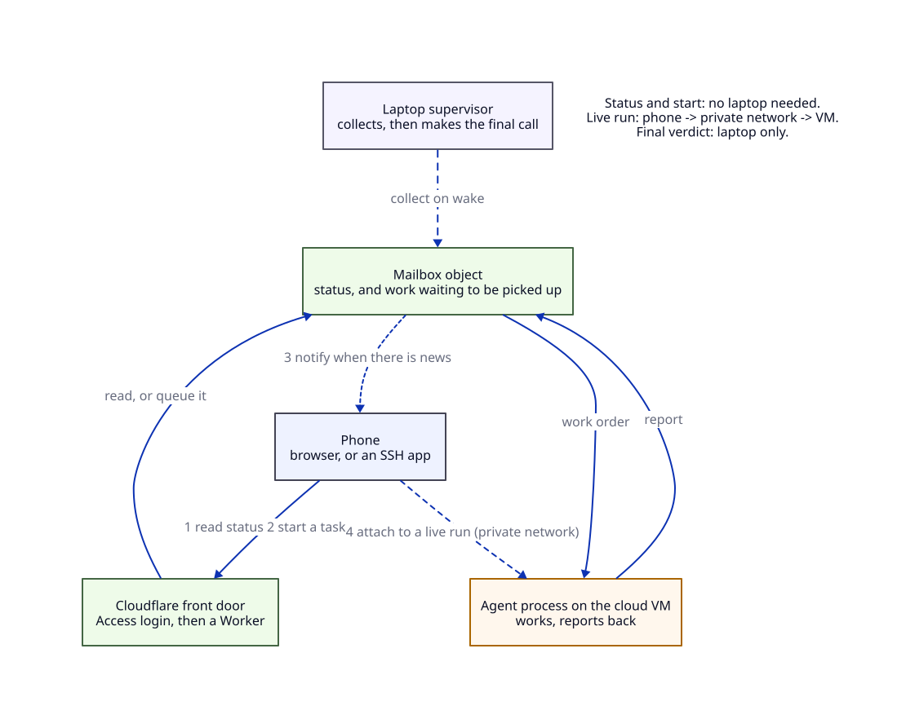

# Cloud agent capabilities, relative to local panes

Companion to [`pi-durable-fit.md`](pi-durable-fit.md), which holds the decision record, the platform facts and
the source registry. **`[S…]` tokens here resolve in `pi-durable-fit.md` §12.**

Legend: **SOLID** = quote-backed, source given per row. **PROJECTED** = nobody has run it; the row carries the
check that settles it. Repo claims cite `path#symbol`, maintained against the current tree (`44a8308` was the
original read point).

---

## 1. SOLID — capability matrix, local peer today vs DO peer today

| Code | Capability             | Local peer today (this repo)                                                                                                                                             | DO peer today (pi-durable 1.4.0)                                                                                                                             | Gap / workaround                                                                  |
| ---- | ---------------------- | ------------------------------------------------------------------------------------------------------------------------------------------------------------------------ | ------------------------------------------------------------------------------------------------------------------------------------------------------------ | --------------------------------------------------------------------------------- |
| M1   | Tool surface           | `read, grep, ls, find, web_fetch`, plus `edit/write` when permitted, `bash` when permitted (`src/peer/peer-config.ts#toolsForPermissions`, `src/pi/tool-permissions.ts`) | `/tools` provides `read`, `write`, `edit`, `bash` (and `powershell`); no grep/ls/find [S5]                                                                   | Port search tools, or accept bash-only search where bash exists at all            |
| M2   | Filesystem (local)     | Real tree at `workspaceRoot` (`src/peer/peer-config.ts`), read/edit/bash against it                                                                                      | None: `ExecutionEnv` is host-supplied and only `env/node` ships [S5][S6]. Remote reads are a separate row (M2b)                                              | External env (container/VM), or inline content in the prompt                      |
| M2b  | Remote file read/write | n/a (has the tree)                                                                                                                                                       | Yes over HTTP: GitHub Contents API, 1 MB per file, 1,000 entries per listing, 5,000 req/h authenticated [S48][S49]; Artifacts is a Git-compatible host [S38] | No local stat, so no mtime-based evidence (see M14)                               |
| M3   | Shell / processes      | `bash` under an allowlist; validation shells out in the supervisor (`src/runtime/runtime.ts#execValidation`)                                                             | No shell at all: `node:child_process` is a stub and no `ExecutionEnv` exists for Workers [S5][S30]; `pi-env` needs the same stub                             | Container or VM. **The one capability with no workaround**                        |
| M4   | CPU / memory / time    | Host machine                                                                                                                                                             | 128 MB, 30 s CPU per request (5 min max), 15 min per alarm, one alarm at a time, 6 outbound connections [S25][S27][S30]                                      | Phase-split long work; page payloads; harness timers avoid hogging the alarm [S5] |
| M5   | Persistence            | Peer session is `SessionManager.inMemory()`; `conversation.jsonl`, `tool-calls.jsonl` and `spans.jsonl` reach disk (`src/runtime/runtime.ts`, `src/peer/peer-main.ts`)   | Committed transcript, typed documents, SQLite; transcript stores "only `output` and `details`" [S4]                                                          | Artifacts must be written deliberately, then collected                            |
| M6   | Survives laptop sleep  | No: 3 s heartbeat, mass crash-marking on wake, peers exit on socket close (`src/runtime/heartbeat-monitor.ts#check`)                                                     | Yes for state: sleeping task "holds no invocation, survives restarts, and resumes at its checkpoint" [S1][S3]                                                | Real for state, not for execution: nothing runs while hibernated                  |
| M7   | Resume                 | `run-state.json` rehydration; loses peer context, locks and in-flight edits (`src/runtime/run-state.ts#buildResumeBriefing`)                                             | `harness.resume()` continues what the last process left; phases rerun from the top [S4]; `restartLimit` parks at 5 [S1]                                      | At-least-once: effects need memo-before-effect                                    |
| M8   | Subagents              | Another herdr pane plus a bus peer                                                                                                                                       | A conversation owned by a task, driven via `api.conversation(id)`; the sample delegates history search to one [S10][S14]                                     | Local pays a pane; DO pays a conversation                                         |
| M9   | Task graph             | Supervisor state machine; panes are the view                                                                                                                             | `harness.taskGraph()` exposes live tasks with `sleeping`, `blocked`, `restart_limit` [S1][S4]                                                                | Nothing local; nothing to port                                                    |
| M10  | Inbox                  | In-process `Map` of sockets; an absent peer gets nothing (`src/runtime/runtime.ts#emit`)                                                                                 | `pi.inbox` queues **submissions**; "failure and task abort leave the inbox alone" [S4]                                                                       | Not an A2A mailbox: needs a custom document plus an owning delivery task          |
| M11  | Liveness               | 1 s heartbeat with busy/progress/retry; stall is display-only (`src/peer/progress-age.ts`)                                                                               | `wake()`/`onWake` plus task graph; no heartbeat concept [S3]                                                                                                 | A DO stall detector must be built on `watch()`                                    |
| M12  | Cost                   | `max_cost_usd` thresholds (`src/budget/budget-enforcer.ts`), not a kill                                                                                                  | Per-model and per-tool usage in documents [S4]                                                                                                               | Neither side enforces a hard stop                                                 |
| M13  | File locks             | Advisory FIFO per path, one lock per agent (`src/locks/file-lock-manager.ts`)                                                                                            | No locks; `edit`/`write` serialize per file by environment id and path [S5]                                                                                  | Serialized, never refused: serialization is not mutual exclusion across hosts     |
| M14  | Success gate           | Validation + `plan.md` + per-criterion verdicts + stale-citation check against local mtimes (`src/runtime/finalize-gate.ts#gateResult`, `runSucceeded` at `44a8308`)     | Nothing. Hooks, documents, task graph only                                                                                                                   | The gate is host-bound: it must share a host with the evidence (§6.5)             |
| M15  | Writers                | One supervisor                                                                                                                                                           | "One process owns a storage at a time; there is no cross-process locking" [S3]                                                                               | Laptop and cloud can never share one storage                                      |

**The asymmetry in one line:** the local peer is a _process with a filesystem_; the DO peer is a _state machine
with a socket and a database_. Durability is the DO's advantage; reach is the local peer's.

---

## 2. PROJECTED — what durability unlocks for this project

Nobody has run any of these. Each row names the check that keeps or kills it.

| Code | Idea                                                         | Durable feature                                                       | Repo problem                                                                                   | POC check (pass = keep)                                                                                                                    |
| ---- | ------------------------------------------------------------ | --------------------------------------------------------------------- | ---------------------------------------------------------------------------------------------- | ------------------------------------------------------------------------------------------------------------------------------------------ |
| P1   | Attestation as a durable task split `read → attest → commit` | Sleeping tasks, phase checkpoints, `restartLimit` parking [S1]        | Supervisor death loses the verdict block entirely                                              | `kill -9` between phases, reopen: verdict committed once, read times come from the checkpoint                                              |
| P2   | Durable review queue across runs                             | Inboxes survive a failed run [S4]                                     | A review request arriving after finalize is dropped                                            | Submit A against a slow model, queue B, close, reopen: B settles, A never duplicates                                                       |
| P3   | A resume contract that replaces `run-state.json`             | Phase checkpoints + `requestId` dedupe + `submission(id)` [S4]        | `buildResumeBriefing` names three unrecoverable losses                                         | Record dispatch position, kill after dispatch, reopen, count dispatches. **Two = fail**                                                    |
| P4   | Reviewer fan-out as child tasks                              | `allSettled`/`failFast` joins, per-conversation agent config [S4]     | One reviewer set from one peer; `criteriaSatisfied` demands one verdict per criterion in order | Feed two verdicts per criterion: must return `false`. If the DoD cannot be partitioned, this buys latency, not rigor                       |
| P5   | Scheduled regression sweeps                                  | Durable sleep + alarm [S1][S27]                                       | `trends` runs only via `import.meta.main`                                                      | Sleep to T+60 s, exit, reopen: one sweep; a restart inside the window runs nothing                                                         |
| P6   | Scorecard/ledger as session documents                        | Session documents survive reopen; `checkpointWhen` now mandatory [S1] | The ledger is parsed line by line                                                              | Reopen and diff against `aggregate(readLedger(...))`. Arrival order is not expressible, which may kill doc-as-ledger                       |
| P7   | Read-only cloud reviewers while the lid is closed            | Conversation with a read-only tool list, cheaper model                | Gate work is local-disk-shaped (K1–K3)                                                         | Inline one artifact and compare with `parseCriteriaBlock`. If every cited path is unattestable, this is a triage helper, not a review peer |
| P8   | Durable supervisor→peer mailbox                              | Custom document plus an owning delivery task                          | `Runtime.emit` drops envelopes for absent peers                                                | Peer offline at emit, comes online: delivered exactly once across a restart                                                                |
| P9   | Replay audit from telemetry                                  | `pi.durable.checkpoint` / `pi.durable.replay` events [S59]            | `spans.jsonl` has no notion of replay                                                          | Count replay events against duplicate `tool-calls.jsonl` rows. Diagnostics "can contain caller content" [S3], so scrub before export       |

---

## 3. PROJECTED — the repo-work half: can a cloud agent edit and test _this_ repo

Repo facts: no `.github/`, `vitest run` under `bun@1.4.2`, bus is a unix socket, panes come from herdr.

| Code | Option                                             | Proven                                                                                                                                                                                                                                      | Not proven                                                                                                                                                                                   |
| ---- | -------------------------------------------------- | ------------------------------------------------------------------------------------------------------------------------------------------------------------------------------------------------------------------------------------------- | -------------------------------------------------------------------------------------------------------------------------------------------------------------------------------------------- |
| W1   | Always-on VM running today's peer unchanged        | Plain Linux runs bun + pi + git; nothing vendor-specific                                                                                                                                                                                    | This suite has never run on a fresh VM; the socket must move (SSH stream-local or an HTTP `PeerLink`)                                                                                        |
| W2   | Cloudflare Sandbox container + Pi                  | "Run the Pi coding agent in a Linux sandbox to edit a GitHub repository from a prompt, then read its changes as a diff" [S34]; clone with the token staying in the Worker [S35]; running tests from a git repo is a documented recipe [S37] | The Pi example pins 0.87.1 and only writes a file — it never runs this suite [S34]; bun and 303 MB of `node_modules` unvalidated; >6 h unproven [S36]                                        |
| W3   | DO + `pi-env` over SSH                             | Tools on another machine, harness local [S5]                                                                                                                                                                                                | **Not deployable on Workers**: `ssh.ts` and `connection.ts` import `node:child_process`                                                                                                      |
| W4   | Bare DO + GitHub API                               | Read and single-file edit via the Contents API [S48], inside 5,000 req/h [S49]; Artifacts as a Git-compatible host [S38]                                                                                                                    | No execution leg; this repo has no CI, so "run the tests" first means adding a workflow — a repo change, not an API call. Also no local mtime, so its citations cannot feed `staleCitations` |
| W5   | DO + a custom `ExecutionEnv` backed by a container | The interface exists and is host-supplied [S6]                                                                                                                                                                                              | Zero implementation, zero test; the vendor frames it as future work                                                                                                                          |

Ranking, cheapest first: **W1**, then **W2** for bursty work, **W4** for read-only triage, **W5** last. W3 is
blocked by code, not by configuration. Artifacts is a Git-compatible host if W4 needs a repo endpoint [S38].

---

## 4. Observability: one trace per run

The goal is OpenTelemetry-shaped insight into each task and agent run. Today there is no OTel pipeline; there
is OTel _naming_ applied by hand. Keep four layers apart, because existing notes conflate them:

| Layer                                                       | Status here                                |
| ----------------------------------------------------------- | ------------------------------------------ |
| L1 OTel-shaped ids / W3C wire                               | Present and hand-rolled                    |
| L2 Trace-API concepts (SpanKind, Resource, links, sampling) | Partly absent, partly divergent            |
| L3 SDK / OTLP exporter / collector                          | Absent by recorded decision                |
| L4 Semantic conventions                                     | Absent; `gen_ai.*` appears nowhere in code |

### 4.1 SOLID — what exists today, in OTel terms

| Code | Fact                                                                                                                                                                                                                                                                                                |
| ---- | --------------------------------------------------------------------------------------------------------------------------------------------------------------------------------------------------------------------------------------------------------------------------------------------------- |
| O1   | "Fields-only tracing (D6): OTel-compatible ids, W3C traceparent propagation, and a span store keyed by span_id — no SDK dependency" (`src/tracing/tracing.ts` docblock)                                                                                                                             |
| O2   | `kind` is a repo taxonomy, not OTel SpanKind: `"run-level"                                                                                                                                                                                                                                          | "work-order-level"` (`shared/traceparent.ts`) |
| O3   | Status is `ok                                                                                                                                                                                                                                                                                       | error                                         | aborted`; OTel has `Unset/Ok/Error`[S51], so`aborted` has no target |
| O4   | The `trace_id` is minted per tracer instance and persisted nowhere; `run-state.json` has no trace fields (`src/runtime/run-state.ts#RunStateV1Schema`)                                                                                                                                              |
| O5   | Propagation is one JSON string field on `WORK_ORDER` and `PROMPT` only; `RESPONSE` and `FINAL_REPORT` carry nothing back (`src/contracts/a2a-schema.ts`, `src/tracing/tracing.ts#inject`)                                                                                                           |
| O6   | Sampling is hardcoded sampled: `00-<trace>--01`, and `parseTraceparent` never reads the flags [S50]                                                                                                                                                                                           |
| O7   | The durable artifact is `run-details/spans.jsonl`, appended fire-and-forget by supervisor and peers to one path                                                                                                                                                                                     |
| O8   | Real runs hold the shape: 544 spans, one `trace_id`, eight span names, zero open spans (`mypi-tasks/run-inspector/run-details/spans.jsonl`)                                                                                                                                                         |
| O9   | No `Resource`, no `service.name`, no instrumentation scope, no baggage, no sampler, no metric instrument                                                                                                                                                                                            |
| O10  | No OTel dependency in the shipped package: `@opentelemetry/*` appears only in a committed probe fixture that `src/` never imports (`scripts/bun-s4-probe/package.json`)                                                                                                                             |
| O11  | `pi-telemetry` is vendor-neutral contracts with no exporter: "vendor-neutral telemetry…" [S58], `pi.*` names are vendor-owned, not semconv [S61]                                                                                                                                                    |
| O12  | Cloudflare Workers can export OpenTelemetry [S40], but "trace IDs are not propagated to services outside of Cloudflare… traces from your Workers will not link with traces from non-Cloudflare services" [S42], and custom spans expose "No `spanContext()`", "No manual parent-child wiring" [S43] |

### 4.2 GAP — distance from a real pipeline

| Code | Gap                                                                                                                 | Consequence                                                                                                                                                                                      |
| ---- | ------------------------------------------------------------------------------------------------------------------- | ------------------------------------------------------------------------------------------------------------------------------------------------------------------------------------------------ |
| G1   | No exporter, no endpoint config                                                                                     | Nothing leaves the machine; zero egress is a recorded decision, not an oversight (`grep` for `OTEL_EXPORTER` in `src/` and `shared/` returns zero hits; `package.json` declares no OTel package) |
| G2   | No `Resource` or `service.name`; the triplet must be globally unique per service [S62]                              | A laptop peer and a cloud peer are indistinguishable at export                                                                                                                                   |
| G3   | Epoch-ms timestamps vs OTLP nanosecond `fixed64` [S56]                                                              | "A serialization pass" is false on this field alone                                                                                                                                              |
| G4   | `kind`, `aborted`, unpopulated `links`, unrecorded remote-parent flag                                               | Every exported span needs remapping or invention                                                                                                                                                 |
| G5   | Logs carry no `trace_id`/`span_id`                                                                                  | A trace cannot be read beside its own narrative                                                                                                                                                  |
| G6   | No metrics signal                                                                                                   | Token/cost/latency trends are re-derived from JSONL (no meter, counter or histogram in `src/tracing/`; the scorecard is derived JSON, `src/scorecard/scorecard.ts`)                              |
| G7   | Resume mints a new `trace_id` and a second root span (code-derived)                                                 | One run can be two traces                                                                                                                                                                        |
| G8   | Spans are written only on `endSpan`; observed artifacts contain `tool` spans whose parent `peer.turn` never appears | The trace loses edges silently instead of recording an error                                                                                                                                     |

### 4.3 PROJECTED — target design

| Code | Rule                                                                                                                                                                                       | Basis                                                            |
| ---- | ------------------------------------------------------------------------------------------------------------------------------------------------------------------------------------------ | ---------------------------------------------------------------- |
| X1   | The supervisor mints the `trace_id` once, before any span, and persists it (`run-state.json` gains trace/span ids); resume reopens the same trace and root                                 | O4, G7 [S50]                                                     |
| X2   | The trace survives sleep as bytes: the supervisor's run-state entry and the cloud peer's `ctx.storage` write of its inbound `traceparent`. Tracer instances and handles are allowed to die | U8                                                               |
| X3   | Cloud spans are hand-authored and parented from the inbound `traceparent`: `dispatch` = CLIENT, cloud `peer.turn` = SERVER. Do not expect Cloudflare's tracing to place them               | O12                                                              |
| X4   | The collector is a gateway on an always-on host, never the laptop; export is best-effort, `spans.jsonl` stays the record of truth                                                          | [S55][S56]                                                       |
| X5   | The cloud peer keeps a span outbox in DO storage, deletes only on 2xx, flushes on wake; at-least-once alarms mean attempts get new span ids and are deduped at read                        | U9 [S27]                                                         |
| X6   | Cross-host timestamps are not causality: read tree edges, carry `clock_skew_ms` [S50]                                                                                                      | K2 is the same defect class, already able to flip a gate verdict |
| X7   | Count gaps: `myma.trace.missing_parent` on extraction failure, surfaced in the scorecard                                                                                                   | G8                                                               |

### 4.4 Spans we would want

Kinds are what we would export, not what the code emits today. GenAI attributes come from the dedicated
semconv repo, where every attribute is Development status [S52][S53]; semconv defines `invoke_agent` as INTERNAL
and a remote variant as CLIENT, and **no SERVER `invoke_agent`**, so a cloud `peer.turn` as SERVER is generic
SpanKind, not a convention. Custom keys use `myma.` because using an existing semconv namespace as a prefix is
explicitly discouraged [S61].

| Span                 | Kind (PROJECTED) | Parent                       | Attributes                                                                                                                                                                 |
| -------------------- | ---------------- | ---------------------------- | -------------------------------------------------------------------------------------------------------------------------------------------------------------------------- |
| `run`                | INTERNAL root    | —                            | `myma.run.id`, `myma.config.hash`                                                                                                                                          |
| `dispatch`           | CLIENT           | `run`                        | `myma.task.id`, `myma.agent.id`                                                                                                                                            |
| `peer.turn`          | SERVER           | `dispatch`/`prompt` (remote) | `gen_ai.agent.id`, `gen_ai.agent.name`, `myma.clock_skew_ms`, `myma.attempt`                                                                                               |
| `model.call` (new)   | CLIENT           | `peer.turn`                  | `gen_ai.operation.name=chat`, `gen_ai.request.model`, `gen_ai.usage.input_tokens`, `gen_ai.usage.output_tokens`, `gen_ai.usage.cache_read.input_tokens`, `myma.cost.total` |
| `tool`               | INTERNAL         | `peer.turn`                  | `gen_ai.tool.name`, `gen_ai.tool.call.id`                                                                                                                                  |
| `prompt`             | CLIENT           | sender's span                | `myma.correlation.id`                                                                                                                                                      |
| `finalize`           | INTERNAL         | `run`                        | `myma.outcome`, `myma.exit_code`, `myma.criteria.{count,passed,failed}`                                                                                                    |
| `validation.command` | INTERNAL         | `finalize`                   | `myma.command`, `myma.exit_code`                                                                                                                                           |

GenAI semconv captures model inputs and outputs as span **events** [S54], and the Span Event API itself is on a deprecation path [S57]; a finalize verdict is therefore recorded as a log-shaped JSONL row keyed by trace and span id, not only as an event.

### 4.5 Cheap now, and what is a project

Cheap (hours, no new dependency, edits the existing record shape): persist the trace id and root span id (X1);
add `span_kind` and `remote_parent`; write one `Resource` line per process segment; emit `gen_ai.usage.*` on a
new `model.call` span from pi's per-message usage; count missing parents; close open spans on abort with a
reason; write `myma.finalize.verdict` as a log-shaped record.

A project (weeks, new failure domains): an OTLP exporter with buffering, sampling and a dropped-span counter —
note the SDK's batching processor drops spans when its queue fills, so export is best-effort by contract and
cannot be the durability mechanism [S56]; a collector gateway with a durable queue [S55][S64]; hand-written OTLP export from
inside the DO; the outbox and dedupe; a `pi-telemetry` adapter; clock-skew calibration and a reader that refuses
to order a trace by timestamp.

### 4.6 What a sleeping laptop does to a live collector

It makes a laptop-hosted collector worthless. A collector agent shares the laptop's fate, its queue is in
memory, and suspending the laptop drops it — the trace truncates at exactly the moment you wanted it. Worse, the
run does not resume cleanly: the 3 s heartbeat wakes with every peer past deadline and mass-marks them crashed
(K8). Therefore the collector cannot be the record, export must be fire-and-forget and countable, and the only
spans guaranteed to exist while the lid is shut are the ones the DO wrote down (X2, X5). A reader must never
treat "spans absent" as "work did not happen".

### 4.7 Smallest first step that yields a real OTel trace

Start with a **replay exporter**, not an SDK: one script that reads one finished run's `spans.jsonl`, maps each
row to an OTLP span, and POSTs OTLP/HTTP JSON to a local `otelcol` with a `debug`+`file` exporter, viewed in
Jaeger. The mapper is where the real work is: ms → `unix_nano` (G3), `run-level|work-order-level` →
`SPAN_KIND_*` (G4), `aborted` → `STATUS_CODE_ERROR` plus a reason (O3), `links: []` dropped, one synthesized
`Resource` per emitting process (G2). Count, inside the mapper, how many fields have no native OTLP target — that
count is the true cost of G4.

Then run it on `mypi-tasks/run-inspector` and confirm one trace, 544 spans, eight names, and intact
`run → dispatch → peer.turn → tool` nesting (O8). Only then delete the replay and put the same mapper behind a
live sink, after X1 has landed — because until X1 lands there is no such thing as "one trace per run" to export.

---

## 5. What this means for the POC

The capability ceiling is the POC's design constraint, not a detail: a DO peer is a reviewer and coordinator
until an execution environment exists (M2, M3, W5), and the gate must share a host with the evidence it reads —
a placement decision, not a config flag (§6.5). The observability work is separable and cheap in its first step
(X1, §4.5), which makes it the one thing worth doing even if the cloud branch is abandoned.

---

## 6. Where the hands live, and how the phone touches it

**Reference style in this section is inline** rather than `[S…]` tokens, because every row carries its own quote
and fetch date: prices move and a token would hide when it was read. All prices were fetched **2026-10-22**
(HTTP 200) and must be re-fetched before buying. Anything without a quote is labelled PROJECTED.

### 6.1 Three tests, and which option fails which

"Always-on" is three separate properties, and vendors only ever mean the first.

| Code | Test                                                                                               |
| ---- | -------------------------------------------------------------------------------------------------- |
| T1   | The plan funds a box for every hour of the month                                                   |
| T2   | The process survives with nobody connected — no idle stop, no idle reclaim, no traffic-based sleep |
| T3   | Something can reach it without the laptop being awake                                              |

T1 is arithmetic and almost everything passes. T2 is where free tiers die. T3 is where laptop-hosted designs die.
Only Oracle documents an idle-reclaim rule; everywhere else, "no idle-stop documented" is silence, not a guarantee.

### 6.2 Recommendation

**Primary — OVHcloud VPS-1, $4.54/month.** 2 vCores / 4 GB / 40 GB NVMe, unlimited traffic, 500 Mbps public
bandwidth, anti-DDoS, daily backup: _"VPS-1 From $4.54 /month … 2 vCores 4 GB RAM 40 GB SSD NVMe … Unlimited
traffic 500 Mbps public bandwidth"_ (`ovhcloud.com/en/vps/`, 200, 2026-10-22T13:21:45Z). It is the cheapest box
that clears the 4 GB floor (§6.9), it is orderable today, and the price is a rate, not a promo. Take an EU or NA
region: the same page's footnote caps APAC VPS-1 at _"500 GB … Beyond this, the bandwidth is capped at 10 Mbps"_.

**Fallback — Oracle Cloud Always Free A1, $0.** 1,500 OCPU-h + 9,000 GB-h/month, _"equivalent to 2 OCPUs and 12 GB
of memory"_, 200 GB block storage, _"10 TB per month of outbound data"_
(`docs.oracle.com/en-us/iaas/Content/FreeTier/freetier_topic-Always_Free_Resources.htm`, 200, 13:20:13Z). It is the
only free plan whose hardware can run this, and it is the only vendor here that documents when it takes the box
back: _"Idle Always Free compute instances may be reclaimed by Oracle … during a 7-day period … CPU utilization
for the 95th percentile is less than 20% … Network utilization is less than 20% … Memory utilization is less than
20% (applies to A1 shapes only)"_ (same page). An agent waiting on model calls is the textbook reclaim candidate.
If you take it: treat the box as cattle, push artifacts off it, and expect signup friction — a real card only
(_"We do not accept … virtual, single-use, or prepaid cards"_, `oracle.com/cloud/free/`, 200, 13:19:54Z), one
account per person, and `"out of host capacity"` is normal.

**Boring escape hatch — DigitalOcean, 2 vCPU / 4 GiB, $24/month**, per-second billing capped at 672 h
(`digitalocean.com/pricing/droplets`, 200, 13:20:00Z). Pay it and stop thinking about the box.

**Free plans that do not genuinely work.** GCP e2-micro is free forever but gives _"1 GB of outbound data
transfer from North America"_ per month (≈33 MB/day) with _"25% CPU time"_
(`cloud.google.com/free/docs/free-cloud-features`, 200, 13:19:58Z) — egress, not RAM, kills it. Vultr's free SKU
exists (`vc2-1c-0.5gb-free`, 512 MB, sea/fra/mia, `api.vultr.com/v2/plans`, 200, 13:23:06Z) and is too small.
AWS is a six-month credit trial and Azure's 750 B1s hours are a 12-month new-customer benefit, so neither is
always-on. Hetzner's Cost-Optimized line rendered _"This product is currently unavailable. Please check back
later."_ on the day of the check (`hetzner.com/cloud/cost-optimized/`, 200, 13:20:47Z), and Contabo's €5.50 is
_"for the first 24 months"_ (`contabo.com/en/vps/`, 200, 13:20:43Z).

### 6.3 What the VM route adds

| Code | What it buys                                                                                                                      |
| ---- | --------------------------------------------------------------------------------------------------------------------------------- |
| C1   | The missing capability is M3: a real shell over a real checkout. A DO peer has neither, and no `ExecutionEnv` exists for Workers  |
| C2   | Run length stops being a platform parameter: no 128 MB, no 30 s CPU, no 15-minute alarm, no six outbound connections              |
| C3   | Parallelism: the six-agent template is ≈1.0–1.2 GB of agent processes, plus ~357 MB for the suite, plus OS — hence the 4 GB floor |
| C4   | Reach without the lid: today nothing can start work while the laptop is shut, because the peer _is_ a process on it               |
| C5   | Runs survive the lid closing; the local peer does the opposite and mass-marks every peer crashed on wake (K8)                     |
| C6   | It does not buy the gate _on the laptop_ — see §6.5, which corrects that framing                                                  |

### 6.4 What Cloudflare is still for

1. **Front door.** Deny-by-default with a login a phone can complete: _"All Access applications are deny by
   default — a user must match an Allow policy before they are granted access"_
   (`developers.cloudflare.com/cloudflare-one/…/self-hosted-public-app/`, 200, 20:20:48Z); email OTP needs no
   identity provider, _"This secure PIN expires 10 minutes after the initial request"_ (one-time-pin, 200,
   20:20:10Z); sessions _"between 15 minutes and one month. The default value is 24 hours"_ (session-management,
   200, 20:23:02Z). Zero Trust Free is _"$0"_, _"forever"_, 50 users (`cloudflare.com/plans/`, 200, 20:20:56Z).
   `cloudflared` is outbound-only: _"a lightweight daemon in your infrastructure … creates outbound-only
   connections to Cloudflare's global network"_ (connect-networks, 200, 20:20:09Z).
2. **Mailbox / always-awake rendezvous.** The only thing that answers while the VM reboots and the laptop is shut.
   A DO with hibernating sockets and alarms (`ctx.acceptWebSocket`, `alarm()`) — this is where a 02:00 work order
   waits.
3. **Home for slow jobs.** Review requests that outlive a run, scheduled sweeps — things that must still exist
   after both machines slept. Alarms, not processes.

What Cloudflare is **not**: the hands. 128 MB, 30 s CPU, no child process [S25][S30]. It holds state and it holds
the door; it does not run tests.

### 6.5 Correction: the judge is a host, not a laptop

The earlier sections say the gate "stays local by construction". That is too strong. K1–K3 bind the gate to
**the host where peers wrote the evidence** — `attesterReadTimes` reads `tool-calls.jsonl`, citations compare
local mtimes, validation shells out in the supervisor's process. Today that host is the laptop only because the
supervisor runs there.

So the real rule is **co-location**: put the supervisor where the peers are, and the gate is coherent there. Two
shapes follow, and they are a genuine choice, not a detail:
- **Laptop judges.** Peers on the VM, supervisor on the laptop, evidence shipped back. Requires the laptop awake
  to finalize, and requires an artifact-shipping path that preserves the files the gate reads.
- **VM judges.** Supervisor and peers both on the VM. The gate runs there, validation runs there, the laptop
  becomes an approver and a viewer. This is the only shape in which a verdict exists while the laptop is shut.

Whichever you pick, one invariant survives: **the peers, the evidence and the gate must share a host.** Split
them and the gate silently degrades (K1) rather than failing loudly.

### 6.6 Verdict: do not run pi-durable on the VM

pi-durable's durability _is_ the Durable Object storage and alarm API. On a VM you would be reimplementing the
platform you were trying to buy, and the project would then hold two recovery contracts at once — the existing
`run-state.json` snapshot and a durable task graph — which is the one conflict this document has flagged since
the first pass.

Split along the line the code already draws: **on the VM**, the pi harness (`pi-coding-agent`, Node ≥22.19,
~100–200 MB per process), the checkout, the toolchain, the run directory, under systemd rather than tmux; **on
Workers**, the door, the status/queue object, notification fan-out, and the last-known status the phone reads when
the VM is down.

### 6.7 What the phone can do

| Action                     | Path                                                                                  | Needs                                                                                                              | Laptop awake?                                      |
| -------------------------- | ------------------------------------------------------------------------------------- | ------------------------------------------------------------------------------------------------------------------ | -------------------------------------------------- |
| Read status                | phone → Access (emailed PIN) → Worker/DO status                                       | Access app + a session                                                                                             | No                                                 |
| Start a run                | phone → Access → authenticated POST that enqueues a work order                        | a start endpoint and a token, not a shell password                                                                 | No                                                 |
| Approve / finalize         | phone → Access → endpoint that writes the decision into the run and releases the gate | an approve verb the supervisor reads; PROJECTED                                                                    | No if the judge is the VM; yes if it is the laptop |
| Attach to a live session   | phone → Tailscale → tailnet IP → `ssh` → `tmux attach`                                | tailscaled on the VM with key expiry disabled or tagged; Termius free, Blink at $19.99/yr (mosh survives cellular) | No                                                 |
| Get notified               | VM → ntfy topic / Telegram bot / Slack or Discord webhook                             | nothing but an outbound POST                                                                                       | No                                                 |
| Start with no inbound port | GitHub `workflow_dispatch` → self-hosted runner on the VM                             | Actions:write token, workflow on the default branch, runner online                                                 | No                                                 |

Sources: Tailscale Personal _"$0 Free forever"_, _"Unlimited user devices"_, non-commercial
(`tailscale.com/pricing`, 200, 20:19:56Z), key expiry _"180 days by default"_ (`tailscale.com/kb/1028/key-expiry`);
ntfy _"Topics are created on the fly"_ and _"the topic is essentially a password"_ (`docs.ntfy.sh/publish/`, 200,
20:21:24Z); dispatch needs _"\"Actions\" repository permissions (write)"_ and a workflow _"must be in the default
branch"_ (`docs.github.com/en/rest/actions/workflows`, 200, 20:21:40Z).

**Unverified and load-bearing:** an Access-protected hostname passing a WebSocket upgrade end to end has no vendor
statement, so a phone UI that relies on it needs one real phone test before you trust it.

### 6.8 The trap this all has to avoid

If the hub stays on the laptop — the supervisor, the tunnel origin, the queue the phone polls, the thing deciding
what runs next — every row above collapses to "works when the lid is open". `cloudflared` and `tailscaled` both
terminate on sleep, so a tunnel to a sleeping laptop is a dead hostname, and an Access login to a dead hostname is
a spinner. Buying a VM does not fix that; it moves the worker and keeps the single point of sleep. The failure is
quiet and looks like a working system, because it was tested with the lid open.

The second-order version is worse: laptop supervisor dispatching to a VM worker means the VM idles exactly when
the laptop sleeps — the window you bought it for. **Work orders must be able to originate where something is
always awake: the VM itself, or the Cloudflare mailbox.**

### 6.9 Before you buy

- **RAM: 4 GB, not 2.** 2 GB is single-agent arithmetic; the six-agent template plus the suite plus the OS does not fit.
- **Disk: 10 GB minimum, 20 comfortable.** One `bun install` is ~303 MB of `node_modules` plus up to ~311 MB of cache; the tree is ~40 MB and `.git` ~23 MB.
- **Egress and region.** GCP's 1 GB/month is a dealbreaker; OVH APAC drops to 10 Mbps after 500 GB.
- **Idle policy in writing.** Only Oracle documents one. Silence is untested, not safe.
- **ARM64 is fine here, on glibc.** esbuild, biome, rolldown and lightningcss publish `linux-arm64` gnu+musl builds; pi's only Linux native module is a 67 KB x11 helper gated on `DISPLAY`, inert headless. Use Debian/Ubuntu, not musl — musl is untested here.
- **Node ≥22.19** for pi, `^22.12 || ^24 || >=26` for vitest.
- **Supervision.** systemd unit with `Restart=always` and **actually enabled** — an `[Install]` section that was never `systemctl enable`d does nothing at boot. Restart on clean exit matters, because an agent loop that finishes its task exits 0.
- **Secrets out of the environment.** systemd says environment variables _"are not suitable for passing secrets"_ and are _"exposed to unprivileged clients via D-Bus IPC"_; use `LoadCredential=`. `/proc/<pid>/environ` keeps the original copy even after you unset it.
- **SSH.** `PasswordAuthentication no` **and** `KbdInteractiveAuthentication no` (the PAM gap), in a numbered file under `/etc/ssh/sshd_config.d/`, verified with `sshd -T`. One key per device.
- **Backups that leave the box.** Hetzner's backup slots exclude attached volumes and snapshots of a running server are not consistency-guaranteed; ship `git bundle` plus run dirs off-box on a timer.
- **Assume the vendor stops you anyway.** Fly is explicit: _"There's no way around it, a Machine will be stopped prior to migration."_ Flush on SIGTERM and resume from durable state regardless of provider.
