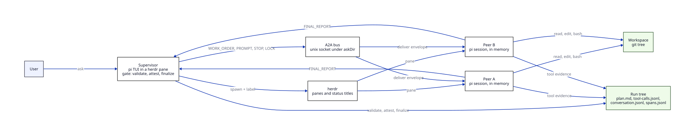
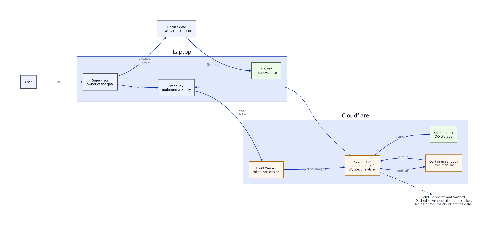
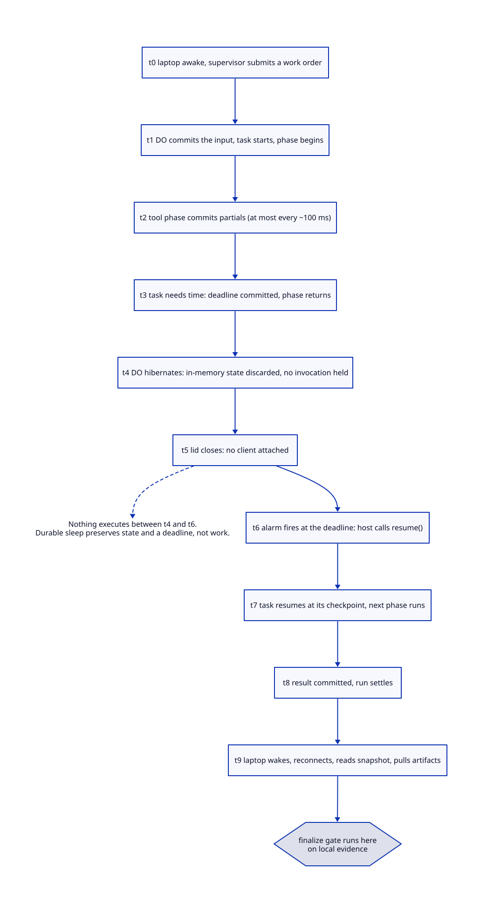

# Pi Durable and cloud peers: fit assessment

Research pass, 2026-10-22, with a second pass the same day. Repo at `44a8308`. Vendor:
`@earendil-works/pi-durable` **1.4.0** (published 2026-10-21T22:44:09Z, tag `v1.4.0` = commit `4a080252`);
`@earendil-works/pi-coding-agent` 1.4.0 (this repo installs 1.0.4).

Supersedes the 2026-10-17 pass (pi-durable 1.3.0, repo `1dd4e6e`). Dead claims are listed in §4, not deleted.

**Citation convention.** Every strong statement — any vendor/platform fact, number, "cannot/only/never", or
behaviour attributed to code — carries a token like `[S12]`. Tokens resolve in §12 with the full URL, HTTP
status, fetch time, verbatim quote and locator. Repo claims cite `path#symbol @ 44a8308` instead, because line
numbers rot. **SOLID** = quote-backed. **PROJECTED** = nobody has run it; the row carries the check that
settles it. Nothing unquoted appears in a SOLID table.

Companion document: [cloud-agent-capabilities](cloud-agent-capabilities.md) — capability matrix, projected
gains, the repo-work half, and observability. It shares this document's `[S…]` numbering.

---

## 1. Headline verdict

pi-durable 1.4.0 is a durable session and task runtime. It ships no model client — the harness takes an
injected `Models` (`readonly models: Models | (() => Models)`, `dist/harness/types.d.ts`) — and no prompt text:
`buildSystemPrompt` is not importable from either package, so prompts are authored with `section()`
(`dist/index.d.ts`), while AGENTS.md and skills loaders are reusable [S5]. What it also does not ship is a
**Workers execution environment** [S5][S6].

A bare DO-hosted agent therefore reads and reasons — its own SQLite, or this repo over the GitHub Contents API
[S48][S49] — and hibernates for as long as a task needs, but it cannot run a shell, install
dependencies, or execute a test suite. Configuring a per-agent model and per-agent prompt is normal usage (§4.1
A1, A2); inheriting pi's built-in prompt kernel is not possible. Every input to this repo's success gate —
attester read times, citation mtimes, validation commands — is read from the host that ran the supervisor, so a
remote reader cannot satisfy the gate from another machine. The gate is **host-bound, not laptop-bound**: put the
supervisor where the peers write evidence and the gate is coherent there (see the companion document §6.5).

The sleep property is real on the durable side: `onWake`, alarms and committed deadlines [S1][S3]. Cloudflare
is a good host for the _durable_ half (coordination, review, triage, search) and a bad host for the _work_
half (install, edit, test). The cheap first hop is a **cloud peer behind a transport seam with the supervisor
local**, proven on a VM; DO is a second implementation of the same seam.

---

## 2. What the previous pass got wrong, and what killed it

| Code | Previous claim                                                                 | Now                                   | Why                                                                                                                                                        |
| ---- | ------------------------------------------------------------------------------ | ------------------------------------- | ---------------------------------------------------------------------------------------------------------------------------------------------------------- |
| W1   | Multi-process locking is `proper-lockfile` in `experimental/session-worker.ts` | Gone                                  | Both files 404 at `v1.4.0`; `src/experimental` holds only `source-resolver.ts` [S5]                                                                        |
| W2   | A published consumer cannot reconstruct the peer surface (trigger T1)          | Half dissolved                        | `loadSkills`, `formatSkillsForPrompt`, `loadProjectContextFiles` are importable from the `pi-coding-agent` root; only the prompt kernel is unexported [S5] |
| W3   | Workers Builds Git integration is Cloudflare's repo story                      | Refuted                               | Artifacts is a Git-compatible repository host [S38]                                                                                                        |
| W4   | There is no pi-durable Cloudflare example                                      | Wrong — it was a search-scope failure | The example is its own repo, `earendil-works/pi-durable-cloudflare` [S8][S14]                                                                              |
| W5   | A DO peer inherits the pi tool surface                                         | Wrong                                 | `/tools` ships read/write/edit/bash/powershell only, and all of them need an `ExecutionEnv` that Workers do not have [S5]                                  |
| W6   | The bus socket lives in `run-details/`                                         | Wrong                                 | It lives under `askDir`, with a temp-dir fallback when the path exceeds 100 chars (`src/bus/socket-server.ts#resolveSocketPath @ 44a8308`)                 |
| W7   | "1.2.0 → 1.4.0 is a small delta"                                               | Wrong                                 | Three hard stops for the official sample, §3 [S1][S8]                                                                                                      |

---

## 3. The 1.2.0 → 1.4.0 delta, and what it does to the official sample

The authoritative source is the package changelog, not the README [S1][S2]. The official sample pins
**1.2.0** [S8], two releases behind.

| Code | Change (quoted)                                                                                                                                                                                                                  | Meaning                                                                                                                |
| ---- | -------------------------------------------------------------------------------------------------------------------------------------------------------------------------------------------------------------------------------- | ---------------------------------------------------------------------------------------------------------------------- |
| B1   | "`TaskRuntime.sleep()` is removed: it waited inside a phase, which holds an invocation and, after a restart, reruns the phase and restarts the wait" [S1]                                                                        | The sample's `runtime.sleep(task.input.runAt, context)` is a compile error [S12]                                       |
| B2   | "Tasks have a `sleeping` status, so code that handles every `TaskState`… needs a case for it" [S1]                                                                                                                               | Exhaustive switches break; any task inspector needs the new kind                                                       |
| B3   | "Opening a SQLite storage migrates it to schema version 2 automatically… A migrated database cannot be opened by 1.3.0 or earlier" [S1]                                                                                          | First 1.4.0 open is a one-way door. Pin versions before the POC                                                        |
| B4   | "Once the count reaches `settings.restartLimit` (default 5; `Infinity` never parks), the task is parked" [S1]                                                                                                                    | Evictions count; a parked task is invisible to `wake()`                                                                |
| B5   | "`defineDoc()` and `defineDocFamily()` require an explicit `checkpointWhen` predicate on every definition" [S1]                                                                                                                  | All three sample definitions omit it; throws at the first delta commit, not the first write                            |
| B6   | "Durable sleeps: a sleeping task holds no invocation, survives restarts, and resumes at its checkpoint" [S1]                                                                                                                     | This, with `onWake` [S3], is what makes hibernation usable                                                             |
| B7   | "In Cloudflare Workers with `nodejs_compat`, the timers that evict idle documents and contexts were armed… a pending one kept a Durable Object from hibernating and blocked its eviction. They are now declined in Workers" [S1] | The pre-1.4 hibernation blocker, **scoped to `nodejs_compat`**. "The 1.2.0 sample cannot hibernate" is not established |
| B8   | 1.4.0 adds `@earendil-works/pi-telemetry` and a `chord/sqlite/cloudflare` dependency [S1]                                                                                                                                        | The Worker bundle must resolve chord 1.4.0, not the sample's 1.2.0                                                     |
| B9   | 1.2.0 section is 6 Breaking / 13 Added / 9 Fixed [S2]                                                                                                                                                                            | The "7 Breaking" in circulation is a miscount                                                                          |
| B10  | Default timers: "A background timer is unreferenced… It is declined in Cloudflare Workers" [S5]                                                                                                                                  | Harness timers do not hold the object awake; per-task timers do not all need the single alarm                          |

**Net for the sample:** three hard stops (B1 compile, B5 runtime, B3 irreversible). Everything else is work,
not risk.

---

## 4. The two official Cloudflare examples

### 4.1 `earendil-works/pi-durable-cloudflare` — the pi-durable one

A multiplayer chat agent. What it demonstrates, with code and tests:

| Code | Fact                                                                                                                                                                          |
| ---- | ----------------------------------------------------------------------------------------------------------------------------------------------------------------------------- |
| A1   | A DO authenticates to a real provider: `createModels()` + `openaiProvider()`, key via `.dev.vars` locally and `wrangler secret put OPENAI_API_KEY` in production [S9][S14]    |
| A2   | One session per DO, many conversations and subagent conversations per DO: `createConversation`, forks, and a subagent as "a child conversation owned by this tool call" [S10] |
| A3   | Hibernation is the normal path: `ctx.acceptWebSocket`, `override async alarm()`, init inside `ctx.blockConcurrencyWhile` [S10]                                                |
| A4   | Durable sleep inside a task phase: `runtime.sleep(task.input.runAt, context)` in `wait`, alarm armed to match [S12], superseded by B1/B6                                      |
| A5   | Restart recovery, scheduling, forks, inboxes and storage conformance have tests against the Cloudflare SQLite adapter [S14]                                                   |
| A6   | Observability without watching thinking: an Activity panel shows "live task ownership, waits, tool calls, and background work" [S14]                                          |
| A7   | The agent's tools are `get_weather` (mock), `schedule`, `search_conversations`, `search_history` (subagent). **No file, shell or repo tool** [S9]                             |
| A8   | `documentRetentionMs: 0` — "Retention timers are active Durable Object references and prevent hibernation" [S9]                                                               |
| A9   | Explicitly not production: "It intentionally has no authentication or rate limiting" [S14]; `POST /api/sessions` mints session ids unauthenticated [S11]                      |

### 4.2 `packages/codemode/examples/cloudflare/` — the script-execution one

Not pi-durable. A `Session` DO owns the tools; scripts run in a separately deployed Worker through
`RemoteCodemodeSandbox`, because `CodemodeSandbox` "needs Node or Bun… Cloudflare Workers have neither, and they
cannot compile WebAssembly at runtime". The sandbox is a QuickJS wasm VM, not a filesystem; tool calls are
"relayed to the host thread as messages" and executed there.

Both examples share one shape: **the DO owns the session and the tools; anything heavier runs somewhere else.**

### 4.3 Ecosystem reality

Third-party use exists and is thin, and the numbers circulating are inflated.

| Code | Fact                                                                                                                                                                                                |
| ---- | --------------------------------------------------------------------------------------------------------------------------------------------------------------------------------------------------- |
| E1   | The official sample has 95 stars, 7 forks, **0 issues and 0 pull requests ever**, 33 commits by one vendor author, pinned 1.2.0 [S15][S16]                                                          |
| E2   | npm downloads are not adoption: 740,046/month for pi-durable, in a window containing three zero days [S17]                                                                                          |
| E3   | 677 public `package.json` dependents (340 pi-server, 265 pi-codemode, 44 pi-env) is a floor, not a population [S18]                                                                                 |
| E4   | Repo search counts are tokenized: the phrase-exact query returns far fewer repos than the numbers quoted in write-ups, and several named "dependents" do not depend on it [S19]                     |
| E5   | Write-ups are thin: HN counts a few dozen hits for the term (32 when first queried, 37 on a second query the same day), 12 stories; the vendor post carries 515 points, third-party items 1–3 [S20] |
| E6   | Friction clusters on DO hosting: a missed sleep deadline "66 s late", a 3 MiB image hitting the 128 MB isolate limit, and two harnesses on one storage running tasks twice [S22][S23][S24]          |
| E7   | One production incident on record: an alarm loop "wrote about 115k rows and took the install down at the free plan's daily cap" [S21]                                                               |

---

## 5. What a Durable Object can and cannot do

| Code | Fact                                                                                                                                                                                                                                   | Source               |
| ---- | -------------------------------------------------------------------------------------------------------------------------------------------------------------------------------------------------------------------------------------- | -------------------- |
| P1   | V8 isolate: no real filesystem (`/tmp` per-request, non-persistent), `node:child_process` a non-functional stub, single-threaded, ~1,000 req/s soft limit per object                                                                   | [S25][S30]           |
| P2   | Alarm handler wall time 15 minutes [S67]; at-least-once with retries [S27]; 6 simultaneous outbound connections, the 7th queued [S25]; 10 GB paid / 1 GB free per object [S67]; 128 MB allocated and billed whether used or not [S66]  | [S25][S27][S66][S67] |
| P3   | Free plan: 100,000 requests/day, 13,000 GB-s/day, **100,000 rows written/day**, 1 GB stored per object; "If you exceed any one of the free tier limits, further operations of that type will fail with an error"                       | [S66]                |
| P4   | Containers/Sandbox: paid only, work inside them "does not count as activity", 6 h max, SIGTERM on terminate, snapshot persistence in public beta                                                                                       | [S31][S32][S36]      |
| P5   | pi-durable ships `env` and `env/node` only; without an env the built-in tools fail                                                                                                                                                     | [S5][S6]             |
| P6   | A DO is reached through a namespace binding from a Worker (`getByName`), and its storage "is private to its unique instance and cannot be accessed by other objects"; the Storage API "is only accessible from within Durable Objects" | [S65][S68][S26]      |

Consequence: no local filesystem (P1) does not mean no access. A DO peer can read this repo over the GitHub
Contents API or Artifacts [S48][S38] and can write single files the same way. What it cannot do is execute:
`bun install`, `vitest run` and any edit-then-test loop need an external execution environment (P5). Read the
constraint as _cannot run_, not _cannot see_.

---

## 6. Durability, sleeps, and the laptop boundary

| Code | Fact                                                                                                                                                                                     | Source          |
| ---- | ---------------------------------------------------------------------------------------------------------------------------------------------------------------------------------------- | --------------- |
| U1   | "With `onWake`, the Harness arms no timer for sleeps… The host keeps its alarm armed and calls `resume()` when it fires"                                                                 | [S3]            |
| U2   | "There is no sleep inside a phase: a phase reruns from its top after a crash or close" — recovery unit is the phase, replay is at-least-once                                             | [S4]            |
| U3   | "`requestId` deduplicates within one conversation before any write" — admission, not effects                                                                                             | [S4]            |
| U4   | "A viewer that only reads never enables scheduling" — a waking client must `submit`, `wait`, `waitForIdle` or `resume()`                                                                 | [S4]            |
| U5   | "Handles belong to that open Harness and must be reacquired after reopen"                                                                                                                | [S4]            |
| U6   | "One process owns a storage at a time; there is no cross-process locking"                                                                                                                | [S3]            |
| U7   | Transcript keeps "only `output` and `details`"; artifacts are not persisted for you                                                                                                      | [S4]            |
| U8   | "When hibernated, the in-memory state is discarded"; an alarm wake re-runs the constructor                                                                                               | [S28]           |
| U9   | Alarms are "at-least-once execution and are retried automatically"                                                                                                                       | [S27]           |
| T1   | Recommended transport: laptop dials `wss://<worker>/api/sessions/<runId>?token=…`; the Worker validates and forwards with `getByName(id).fetch`; the DO accepts with the hibernating API | [S10][S11][S29] |
| T2   | "Calling accept()… will incur duration charges for the entire time the WebSocket is connected. It is recommended to use the WebSocket Hibernation API"                                   | [S30]           |
| T3   | Worker-level Access "will fail with a `403` error" on WebSocket upgrades; a hostname-based Access application is the documented shape and can cover a `workers.dev` hostname             | [S39]           |
| T4   | "A client that joins late or reconnects starts from the current view; nothing is replayed"                                                                                               | [S13]           |

Net: the sleep property is real for state (U1–U2, U8), results are collectable on wake (U3–U5, T4), artifacts
are yours to write (U7), and the laptop must reach the DO through a Worker with a token you invent (P6, T1–T3).

---

## 7. Constraints this repo cannot avoid

| Code | Constraint                                                                                                                                                                        | Cite                                                                                                 |
| ---- | --------------------------------------------------------------------------------------------------------------------------------------------------------------------------------- | ---------------------------------------------------------------------------------------------------- |
| K1   | Attester read times come from the run's own `tool-calls.jsonl` on local disk; a missing file degrades to an empty map, so a remote attester weakens the gate **without erroring** | `src/runtime/runtime.ts#attesterReadTimes`                                                           |
| K2   | Citation freshness is a local `statSync().mtimeMs` against a peer-generated timestamp: cross-host clock skew flips the verdict                                                    | `src/runtime/runtime.ts#citedMtime`, `src/supervisor/finalization.ts#staleCitations`                 |
| K3   | Validation runs `sh -c <command>` in the supervisor process, so a remote agent's changes are never actually validated                                                             | `src/runtime/runtime.ts#execValidation`, `src/validation/validation-runner.ts#runValidation`         |
| K4   | The bus is a Unix-domain socket at a filesystem path; no host/port/TLS surface; peers receive only that path                                                                      | `src/bus/socket-server.ts#resolveSocketPath`, `src/peer/peer-main.ts`                                |
| K5   | "Reachable" means "has a local socket handle"; delivery is a write into an in-process `Map`                                                                                       | `src/runtime/runtime.ts#emit`                                                                        |
| K6   | Launch is `bun <local peer script> --config <local config path>` into a herdr pane keyed by `HERDR_PANE_ID`                                                                       | `src/runtime/runtime.ts#start`, `src/herdr/pane-manager.ts`                                          |
| K7   | Locks are one in-memory advisory `Map` keyed by a caller-supplied path string                                                                                                     | `src/locks/file-lock-manager.ts`                                                                     |
| K8   | Liveness is a 3 s wall-clock heartbeat; a suspended laptop wakes with every peer past deadline and mass-marks them crashed, and each peer exits when its socket closes            | `src/runtime/heartbeat-monitor.ts#check`, `src/peer/peer-main.ts`, `src/contracts/session-schema.ts` |
| K9   | Resume re-enters the local launch path (`rehydrate → start → spawnPeers`), so a remote peer cannot be resumed by existing code                                                    | `src/runtime/runtime.ts#resume`                                                                      |
| K10  | `WORK_ORDER` carries no workspace identity, host or path base; `contextFiles` and `localDoD` are bare strings                                                                     | `src/contracts/a2a-schema.ts`                                                                        |
| K11  | `AgentSchema` is a strict object with no transport/endpoint/execution field; unknown keys are rejected                                                                            | `src/contracts/session-schema.ts`                                                                    |

The protocol half is already transport-neutral: `JsonlFramer.push`, `routeFrame` and `handleInboundLine` take
strings only. Only link ownership and process launching are local, which is why the seam is small even though
K4–K9 are pervasive.

---

## 8. What this means for the config schema

The schema can decide **where a peer runs and what it may do there**. It cannot decide where the gate runs:
K1–K3 make finalization structural. Making attestation configurable would let a config file disable the
product's only real check.

```yaml
agents:
  - id: reviewer
    execution: cloud-do # new discriminator; default "local-pane"
    capabilities: # declared, never inferred
      read: true
      edit: false # true is a parse error for cloud-do (P5)
      shell: false
      network: [model] # model | git | none
    cloud: # legal only when execution: cloud-do
      endpoint: https://... # front Worker route; DO name is per-run, not per-agent
      result_channel: poll # nothing can dial a unix socket back
      deadline_ms: 3600000
      collect: [final.md, tool-calls.jsonl, conversation.jsonl]
    workspace_ref: <commit-sha> # grounds contextFiles across hosts (K10)
```

| Code | Field                         | Why                                                                                        |
| ---- | ----------------------------- | ------------------------------------------------------------------------------------------ |
| D1   | `execution`                   | K11: no way to declare remoteness today; K4–K6 mean the transport is selected, not sniffed |
| D2   | `capabilities`                | P5: `edit`/`shell` on a DO must fail at parse time, not at tool-call time                  |
| D3   | `cloud.collect[]`             | U7: artifacts are not persisted automatically; name them before the attester runs          |
| D4   | `cloud.deadline_ms`           | U2: the deadline belongs in committed state, not a sleeping phase                          |
| D5   | `workspace_ref`               | K10: a remote peer needs a commit sha, not the receiver's tree                             |
| D6   | per-agent `liveness` override | K8: 3 s is wrong across a network, but must not disable crash marking locally              |
| D7   | `run.request_namespace`       | U3: dedupe is per conversation; reused ids need namespacing                                |

Must **not** enter the schema: attester identity or any gate switch (K1–K3, `captureCriteria`); where
finalization runs; provider credentials or DO ids (A9: no vendor credential path, and the sample's own warning
is that anyone reaching it spends your key); raw socket paths or transport internals; per-agent tool lists that
assume local exec; any field whose default changes local behaviour.

**The pivotal non-decision.** Where the supervisor lives is not a per-ask choice. A cloud coordinator can keep
cloud peers unblocked (U1, U4) but cannot close a run, because the gate needs local evidence. The configurable
question is whether the _dispatcher_ is local; the _finalizer_ is local by construction.

---

## 9. Diagrams

Sources: [`diagrams/architecture.d2`](diagrams/architecture.d2),
[`diagrams/hybrid.d2`](diagrams/hybrid.d2), [`diagrams/sleep-flow.d2`](diagrams/sleep-flow.d2).
Rendered: `.svg` for reading, `.png` for review.







Solid labels and edges assert what the code or the vendor documents say; anything drawn as a proposal is
labelled as such in the diagram title. `trace-topology.d2` lives in the companion document §5.

---

## 10. What the POC must prove, in order

| Code | Gate                                                    | Pass                                                                                                                    | Fail means                                                                                    |
| ---- | ------------------------------------------------------- | ----------------------------------------------------------------------------------------------------------------------- | --------------------------------------------------------------------------------------------- |
| G1   | Sample ported to 1.4.0, `tsc --noEmit` clean            | Only B1, B3, B5 needed code changes                                                                                     | Anything else → the API is not stable enough to build on                                      |
| G2   | Eviction + alarm recovery on 1.4.0 under `wrangler dev` | `getAlarm()` survives eviction; `runDurableObjectAlarm` completes the task                                              | No hibernation → the "laptop asleep" premise dies                                             |
| G3   | Real credential, real model, one tool call              | Failure is only the missing-env error (P5), nothing earlier                                                             | Import or memory failure → stop before transport work **A measurement, not a sourced claim.** |
| G4   | Artifact round-trip for one run                         | Collected files feed `attesterReadTimes` and `staleCitations`                                                           | Missing artifacts → cloud peers cannot feed the gate                                          |
| G5   | Rows written for one real run                           | Under 100,000/day on free, or paid cost stated and accepted                                                             | Cap exceeded → the $5 floor is not the real number **A measurement, not a sourced claim.**    |
| G6   | Cloud edit path on this repo                            | `bun install && bun run test` green on the same commit the supervisor validates                                         | Never run → no cloud _worker_ peer, only cloud _reviewers_                                    |
| G7   | Config discriminator                                    | Two `session.yaml` differing only in `execution` yield the same verdict shape; `cloud-do + edit: true` is a parse error | Verdict shape differs → the field is policy; revert it                                        |

Stop rule: G2 failing ends the DO branch; G4 failing ends cloud peers as gate input. G6 failing narrows the
project to reviewers, which is still worth having.

---

## 11. Unverified

| Code | Open claim                                                                                                | What closes it                                                                                                             |
| ---- | --------------------------------------------------------------------------------------------------------- | -------------------------------------------------------------------------------------------------------------------------- |
| X1   | pi-durable 1.4.0 runs under Workers with `createCodingTools()` installed, failing only on the missing env | Port `test-workers/worker.ts`, call `read`, read the error                                                                 |
| X2   | This repo's peer already replays its transcript after `SIGKILL`                                           | Kill a peer mid-turn and inspect the next turn                                                                             |
| X3   | A hostname-based Access app authenticates a **WSS upgrade**                                               | Docs recommend the app type; no page states WebSocket behaviour [S39]                                                      |
| X4   | `documentRetentionMs: 0` is obsolete after B7                                                             | Observe eviction on 1.4.0                                                                                                  |
| X5   | Rows written per harness commit                                                                           | Measure one run; freemium math is otherwise inferred from the 100 ms commit interval **Not a claim, a measurement** [S66]. |
| X6   | A local bus dedupes a repeated `WORK_ORDER`                                                               | No `requestId` or sequence check exists in `router.ts`/`peer-harness.ts`                                                   |

---

## 12. Sources

Tokens are shared with the companion document. Quotes reproduce the source; where the source itself contained a
hyperlink it is shown as "(link elided)" so the quote stays inside markdown without inventing a URL. Fetched 2026-10-22; "HTTP" is the observed status; each entry
carries up to three verbatim quotes from that URL with the locator needed to re-check them, and wherever a claim
spans more than the quoted fragment the locator is the proof path.

**Repo sources.** Claims citing `path#symbol @ 44a8308` were read from this working tree at commit `44a8308`:
`src/runtime/{runtime,run-state,heartbeat-monitor}.ts`, `src/bus/{socket-server,router,jsonl-framer}.ts`,
`src/peer/{peer-main,peer-config,peer-harness,progress-age,change-notifier,tool-call-logger}.ts`,
`src/herdr/{pane-manager,herdr-client}.ts`, `src/locks/file-lock-manager.ts`,
`src/contracts/{session-schema,a2a-schema,criteria}.ts`, `src/supervisor/{finalization,reconciliation}.ts`,
`src/validation/{validation-runner,run-contract,change-detector}.ts`, `src/logging/conversation-log.ts`,
`src/tracing/{tracing,peer-trace}.ts`, `shared/traceparent.ts`, `src/budget/budget-enforcer.ts`,
`src/scorecard/`, `package.json`. Reproduce any of them with `git show 44a8308:<path>`.
- **[S1]** <https://raw.githubusercontent.com/earendil-works/pi/v1.4.0/packages/durable/CHANGELOG.md> — HTTP 200, fetched 2026-10-22T19:05:49Z
  - "In Cloudflare Workers with nodejs_compat, the timers that evict idle documents and contexts were armed... a pending one kept a Durable Object from hibernating and blocked its eviction. They are now declined in Workers ... `Harn..." (`CHANGELOG [1.4.0] Fixed / Added sections`)
  - "`Harness.wake()` and `HarnessOptions.onWake` tell a host when the Session next needs a process: `active` while work can run, `at` for the earliest sleep. With `onWake`, the Harness keeps no timer for sleeps, so a Cloudflare Dur..." (`CHANGELOG.md §[1.4.0] Added#6`)
  - "Added `HarnessOptions.identity` (a pi-ai `ClientIdentity`) to set the `User-Agent` and provider attribution of every model request through the Harness, including hooks and tools. `api.models` in tools and hooks is now a wrapper..." (`CHANGELOG.md §[1.4.0] Added#11`)
- **[S2]** <https://raw.githubusercontent.com/earendil-works/pi/v1.3.0/packages/durable/CHANGELOG.md> — HTTP 200, fetched 2026-10-22T19:05:49Z
  - "`toBase64`, used by `read` and the Photon image processor, no longer takes about 140 MB of heap to encode a 3 MiB image, which exceeded the 128 MB memory limit of a Cloudflare Durable Object; it now builds a binary string 8 KiB..." (`CHANGELOG.md §[1.3.0] Fixed#2 (#10923)`)
  - "The system baseline written after a compaction now leads the model context when the kept history includes an assistant message, as does a first baseline written after earlier answers, instead of following the new input" (`CHANGELOG.md §[1.3.0] Fixed#1 (#10904)`)
  - "`SqliteStorage.open(database, { prefix })` can namespace every table and index; `openNodeSqliteStorage()` and `openDurableObjectSqliteStorage()` forward it, for databases shared with host tables." (`CHANGELOG.md §[1.3.0] Added#1`)
- **[S3]** <https://raw.githubusercontent.com/earendil-works/pi/v1.4.0/packages/durable/README.md> — HTTP 200, fetched 2026-10-22T19:07:01Z
  - "With `onWake`, the Harness arms no timer for sleeps; it tells the host what `harness.wake()` says whenever that changes: `active` while some task can run now or is running, and `at`, the earliest sleep." (`README.md §Sleeping and Waking Up`)
  - "Once the count reaches `settings.restartLimit` (default 5; `Infinity` never parks), the task is parked: `inspect()` and the task graph show it as blocked with reason `restart_limit`" (`README.md §Failures and Recovery, "Crash loops"`)
  - "There is no sleep in the middle of a phase: a phase reruns from its top after a restart, so work after the wait goes in the next phase, and what it needs goes in the checkpoint." (`README.md §Sleeping and Waking Up`)
- **[S4]** <https://raw.githubusercontent.com/earendil-works/pi/v1.4.0/packages/durable/docs/spec.md> — HTTP 200, fetched 2026-10-22T19:18:11Z
  - "**Queued items after a failed run:** failure and task abort leave the inbox alone. Queued follow-ups wait in `pi.inbox`, and their `wait()` does not settle, until the next input or queued write's boundary places them or the hos..." (`docs/spec.md §12 API footguns`)
  - "Opening applies pending schema migrations in one transaction; schema version 2 rebuilds the task table to admit the `sleeping` status. A database migrated by a newer version is refused by an older one." (`docs/spec.md:5398-5400 (§11.2 SQLite)`)
  - "There is no sleep inside a phase: a phase reruns from its top after a crash or close, so an in-memory wait would hold an invocation, and a deadline computed inside the phase would move on every rerun." (`docs/spec.md:2417-2419 (§5.6)`)
- **[S5]** <https://registry.npmjs.org/@earendil-works/pi-durable/-/pi-durable-1.4.0.tgz> — HTTP 200, fetched 2026-10-22T19:18:11Z
  - "The default `HarnessOptions.setTimer`: `setTimeout`, waiting out delays beyond its limit in steps. A background timer is unreferenced, so it never keeps the process alive. It is declined in Cloudflare Workers and wherever timer..." (`package/dist/timers.d.ts:2-5`)
  - "calls `onWake` after open and whenever `Harness.wake()` changes, and the host arms its own wakeup, such as a Durable Object alarm, and calls `resume()` when it fires. Called off the Session line, after the commit that" (`package/dist/harness/types.d.ts:587-590`)
  - "A host whose process can be evicted, such as a Cloudflare Durable Object, wakes it itself. With `onWake`, the Harness arms no timer for sleeps; it tells the host what `harness.wake()` says whenever that changes" (`package/README.md:166 (§Sleeping and Waking Up)`)
- **[S6]** <https://raw.githubusercontent.com/earendil-works/pi/v1.4.0/packages/durable/test/examples/28-reviewer.ts> — HTTP 200, fetched 2026-10-22T19:07:38Z
  - "// Everything the reviewer is, stored on its conversation: the model, exactly these extensions in this order, only // the read tool, and its directory. A restart keeps all of it." (`test/examples/28-reviewer.ts, host setup after registry.install(Reviewer)`)
  - "env: ({ cwd = process.cwd() }) => new NodeExecutionEnv({ cwd })," (`test/examples/28-reviewer.ts, Harness.open options`)
- **[S7]** <https://raw.githubusercontent.com/earendil-works/pi/v1.4.0/packages/durable/test/harness-sleep.test.ts> — HTTP 200, fetched 2026-10-22T19:07:38Z
  - "it("sleeps without an invocation and resumes at its checkpoint once due", async () => { let clock = 1_000; const wakes: Wake[] = [];" (`test/harness-sleep.test.ts:88-91, with openTasks(new MemoryStorage(), [Nap], { now: () => clock, onWake })`)
- **[S8]** <https://raw.githubusercontent.com/earendil-works/pi-durable-cloudflare/main/package.json> — HTTP 200, fetched 2026-10-22T19:18:11Z
  - ""@earendil-works/pi-durable": "1.2.0", "@earendil-works/chord": "1.2.0", "@earendil-works/pi-ai": "1.2.0"" (`package.json dependencies`)
  - ""@earendil-works/pi-durable": "1.2.0"," (`package.json:20`)
  - ""@earendil-works/pi-durable": "1.2.0"," (`package.json, dependencies`)
- **[S9]** <https://raw.githubusercontent.com/earendil-works/pi-durable-cloudflare/main/src/chat.ts> — HTTP 200, fetched 2026-10-22T19:06:00Z
  - "// Retention timers are active Durable Object references and prevent hibernation. documentRetentionMs: 0," (`src/chat.ts ~line 55, settings block`)
  - "// Retention timers are active Durable Object references and prevent hibernation. documentRetentionMs: 0," (`src/chat.ts, createChatHarnessOptions settings block`)
  - "tools: [getWeatherTool, scheduleTool, searchHistoryTool]," (`src/chat.ts:25 and :47; no `env:` key in the returned HarnessOptions`)
- **[S10]** <https://raw.githubusercontent.com/earendil-works/pi-durable-cloudflare/main/src/session.ts> — HTTP 200, fetched 2026-10-22T19:18:11Z
  - "#refreshAlarm(): const { tasks } = await this.#harness.inspect(BACKGROUND_CONTEXT); const scheduled = scheduledDeadline(task); ... // waitForTask starts the scheduler, so persist its recovery alarm first." (`src/session.ts:626-647, constant RECOVERY_ALARM_DELAY_MS = 60_000 at line 50`)
  - "const doc = await tx.doc(ConversationCommandReceipts, command.requestId, null);" (`Session.#handleCommand(), prompt.submit branch, src/session.ts:363`)
  - "const requested = new URL(request.url).searchParams.get("username") ?? "";" (`usernameForConnection(), src/session.ts:118-119`)
- **[S11]** <https://raw.githubusercontent.com/earendil-works/pi-durable-cloudflare/main/src/index.ts> — HTTP 200, fetched 2026-10-22T19:11:16Z
  - "// Demo-only surface: authenticate and rate limit before exposing model-backed rooms publicly." (`src/index.ts:28`)
  - "return env.SESSIONS.getByName(sessionMatch[1]).fetch(request);" (`src/index.ts:29 (handler for /^\/api\/sessions\/([^/]+)\/?$/)`)
- **[S12]** <https://raw.githubusercontent.com/earendil-works/pi-durable-cloudflare/main/src/schedule.ts> — HTTP 200, fetched 2026-10-22T19:18:11Z
  - "export const DeliverScheduledInstruction = defineTask<ScheduledInstruction, DeliveryState, null>({ name: "app.deliver-scheduled-instruction", version: 1, initial: () => ({ phase: "wait" })," (`src/schedule.ts:216-220, wait phase calls runtime.sleep(task.input.runAt, context)`)
  - "await runtime.sleep(task.input.runAt, context);" (`src/schedule.ts:222 (DeliverScheduledInstruction.phases.wait)`)
- **[S13]** <https://raw.githubusercontent.com/earendil-works/pi-durable-cloudflare/main/src/client/usePiSession.ts> — HTTP 200, fetched 2026-10-22T19:11:16Z
  - "shouldReconnectOnClose: (event) => !terminal && !terminalProtocolClose(event.code)," (`usePiSession.ts:55, with terminalProtocolClose at line 15 (1002 || 1009)`)
  - "outbox.replay((command) => socket.send(JSON.stringify(command)));" (`usePiSession.ts:118 (inside the session.snapshot handler)`)
  - "host: window.location.host," (`src/client/usePiSession.ts:49-56 (PartySocket constructor options: party 'sessions', prefix 'api', room sessionId, query { username })`)
- **[S14]** <https://raw.githubusercontent.com/earendil-works/pi-durable-cloudflare/main/README.md> — HTTP 200, fetched 2026-10-22T19:11:16Z
  - "This is a sample, not a production service. It intentionally has no authentication or rate limiting." (`README.md, paragraph before 'Run it locally'`)
- **[S15]** <https://api.github.com/repos/earendil-works/pi-durable-cloudflare> — HTTP 200, fetched 2026-10-22T19:05:56Z
  - "full_name = earendil-works/pi-durable-cloudflare ... stargazers_count = 95 ... forks_count = 7 ... open_issues_count = 0 ... created_at = 2026-09-23T21:27:30Z ... pushed_at = 2026-10-15T15:06:05Z" (`repo JSON fields`)
- **[S16]** <https://api.github.com/repos/earendil-works/pi-durable-cloudflare/issues?state=all&per_page=100> — HTTP 200, fetched 2026-10-22T19:06:04Z
  - "[] (count 0); pulls?state=all -> count 0" (`issues and pulls endpoints, empty arrays`)
- **[S17]** <https://api.npmjs.org/downloads/point/last-month/@earendil-works/pi-durable> — HTTP 200, fetched 2026-10-22T19:05:48Z
  - "{"downloads":740046,"start":"2026-09-19","end":"2026-10-18","package":"@earendil-works/pi-durable"}" (`downloads/point endpoint; same endpoint queried per package`)
- **[S18]** <https://api.github.com/search/code?q=%22@earendil-works/pi-durable%22+filename:package.json> — HTTP 200, fetched 2026-10-22T19:07:27Z
  - "total=677 incomplete=false" (`search/code total_count, authenticated via gh (token scopes gist,read:org,repo)`)
- **[S19]** <https://api.github.com/search/repositories?q=pi-durable+in:name,description&sort=stars&order=desc&per_page=50> — HTTP 200, fetched 2026-10-22T19:07:01Z
  - "2409 The-Vibe-Company/companion ... 584 TannerMidd/pi-pocket ... 275 finnvoor/PiDurableKit ... 246 disler/durable-pi ... 196 vercel-labs/durable-harness ... 165 langgenius/mosoo" (`search/repositories items[].{full_name,stargazers_count}`)
  - "total_returned=50 stars>=100:9 stars20-99:18" (`search/repositories total_count=441 (first page query, per_page=1); star histogram from sort=stars page`)
- **[S20]** <https://hn.algolia.com/api/v1/search?query=pi-durable&tags=(story,comment)> — HTTP 200, fetched 2026-10-22T19:06:04Z
  - "nbHits 32 - 2026-10-01 | pts 515 | Pi Durable | https://earendil.com/posts/pi-durable/ ... 2026-10-03 | pts 2 | Pi Durable, as Statecharts | https://scxmljs.tinyactors.dev/demos/pi-durable/ ... 2026-10-05 | pts 1 | Pi Durable: ..." (`hn.algolia.com search hits[].{created_at,points,title,url}`)
- **[S21]** <https://github.com/keyurbodar/kiko/issues/26> — HTTP 200, fetched 2026-10-22T19:07:01Z
  - "On 2026-10-19, two idle agents set off an alarm loop that wrote about 115k rows and took the install down at the free plan's daily cap. The loop came from the heartbeat in `core/agent/src/host.ts`. When an alarm failed, it back..." (`issue 26 body, PR 1 of 'one-object redesign'`)
- **[S22]** <https://github.com/earendil-works/pi/issues/10857> — HTTP 200, fetched 2026-10-22T19:06:41Z
  - "#sleep is an in-memory setTimeout, and a Durable Object runs code only for a request or an alarm. A pending timer keeps the object alive for at most 15 minutes... So a sleep longer than 15 minutes misses its deadline every time..." (`issue 10857 body, reporter odysseus0, Version 1.1.0`)
- **[S23]** <https://github.com/earendil-works/pi/issues/10923> — HTTP 200, fetched 2026-10-22T19:06:41Z
  - "Actual: process aborts (exit 134): FATAL ERROR: Reached heap limit Allocation failed - JavaScript heap out of memory ... the exact 3,147,295-byte PNG ... increases heapUsed by 138,481,088 bytes" (`issue 10923, reporter fitchmultz, Versions pi-durable 1.2.0`)
- **[S24]** <https://github.com/finnvoor/PiDurableKit/issues/5> — HTTP 200, fetched 2026-10-22T19:07:01Z
  - "The pi-durable README says one process owns a storage at a time and that there is no cross-process locking. Harness.open documents the same rule but does not enforce it. If two harnesses open one SQLite file or JSONL directory,..." (`issue 5, reporter jasonkneen, still open`)
- **[S25]** <https://developers.cloudflare.com/durable-objects/platform/limits/index.md> — HTTP 200, fetched 2026-10-22T19:09:36Z
  - "| Simultaneous outgoing connections/request | 6 (same as [Workers](https://developers.cloudflare.com/workers/platform/limits/#simultaneous-open-connections)) |" (`DO limits table`)
  - "maximum storage limit] (10 GB on Workers Paid, or 1 GB on the Free plan)" (`note on storage-limit errors (md line 120); general table gives 'Storage per Durable Object | 10 GB'`)
  - "WebSocket message size | 32 MiB (only for received messages)" (`SQLite-backed Durable Objects general limits table`)
- **[S26]** <https://developers.cloudflare.com/durable-objects/platform/pricing/> — HTTP 200, fetched 2026-10-22T19:08:29Z
  - "Calling accept() on a WebSocket in an Object will incur duration charges for the entire time the WebSocket is connected. It is recommended to use the WebSocket Hibernation API to avoid incurring duration charges once all event ..." (`Compute billing, footnote 4`)
  - "Storage billing for SQLite-backed Durable Objects will be enabled in January 2026, with a target date of January 7, 2026 (no earlier)." (`section 'SQLite storage backend', first paragraph`)
  - "The Durable Objects Storage API is only accessible from within Durable Objects." (`section 'Storage billing', first paragraph`)
- **[S27]** <https://developers.cloudflare.com/durable-objects/api/alarms/> — HTTP 200, fetched 2026-10-22T19:19:55Z
  - "Alarms have guaranteed at-least-once execution and are retried automatically when the alarm() handler throws." (`Overview`)
  - "Each Durable Object is able to schedule a single alarm at a time by calling setAlarm()." (`Overview`)
- **[S28]** <https://developers.cloudflare.com/durable-objects/concepts/durable-object-lifecycle/> — HTTP 200, fetched 2026-10-22T19:19:55Z
  - "the first incoming request or event (like an alarm) will execute the constructor() of the Durable Object class, then run the corresponding function invoked." (`Lifecycle of a Durable Object, Overview`)
  - "When hibernated, the in-memory state is discarded, so ensure you persist all important information in the Durable Object's storage." (`Lifecycle states, Caution note`)
- **[S29]** <https://developers.cloudflare.com/durable-objects/best-practices/create-durable-object-stubs-and-send-requests/> — HTTP 200, fetched 2026-10-22T19:08:16Z
  - "The URL associated with the Request object passed to the fetch() handler of your Durable Object must be a well-formed URL, but does not have to be a publicly-resolvable hostname." (`section 'Invoking the fetch handler', note after the RPC/fetch comparison`)
  - "public methods on the Durable Objects class are exposed as RPC methods" (`section 'Invoke RPC methods', first paragraph`)
- **[S30]** <https://developers.cloudflare.com/workers/platform/limits/index.md> — HTTP 200, fetched 2026-10-22T19:16Z
  - "| [Subrequests](#subrequests) | 50/request | 10,000/request | ... | [Simultaneous outgoing connections/request](#simultaneous-open-connections) | 6 | 6 |" (`Account plan limits table`)
- **[S31]** <https://developers.cloudflare.com/containers/platform/pricing/> — HTTP 200, fetched 2026-10-22T19:12:14Z
  - "Containers are billed for every 10ms that they are actively running at the following rates, with included monthly usage as part of the $5 USD per month Workers Paid plan: ... 25 GiB-hours/month included +$0.0000025 per addition..." (`## vCPU, Memory and Disk`)
  - "Memory and disk usage are based on the _provisioned resources_ for the instance type you select, while CPU usage is based on _active usage_ only." (`## vCPU, Memory and Disk`)
- **[S32]** <https://developers.cloudflare.com/containers/platform/limits/> — HTTP 200, fetched 2026-10-22T19:12:14Z
  - "| Image size | Same as instance disk space | ... | Total image storage per account | 50 GB | ... | Maximum snapshot size | 20 GB | ... | Snapshot retention | 30 days from creation or the most recent restore |" (`## Account limits, ## Snapshot limits`)
  - "| standard-1 | 1/2 | 4 GiB | 8 GB | ... | Maximum vCPU | 4 | ... | Maximum Memory | 12 GiB | ... | Maximum Disk | 20 GB |" (`## Instance Types and ## Custom Instance Types`)
- **[S33]** <https://developers.cloudflare.com/sandbox/coding-agents/> — HTTP 200, fetched 2026-10-22T19:14:26Z
  - "Coding agents such as Claude Code, Codex, and OpenCode can run a task on their own: they read a repository, edit files, and run commands until the task is done." (`first paragraph`)
- **[S34]** <https://developers.cloudflare.com/sandbox/coding-agents/pi/> — HTTP 200, fetched 2026-10-22T19:12:13Z
  - "RUN npm install --global --ignore-scripts @earendil-works/pi-coding-agent@0.87.1 ... The image pins the version, because the flags and event format of Pi can change between releases." (`step 1 Dockerfile and following paragraph`)
  - "Run the Pi coding agent in a Linux sandbox to edit a GitHub repository from a prompt, then read its changes as a diff." (`description/first paragraph`)
- **[S35]** <https://developers.cloudflare.com/sandbox/network/clone-a-private-repository/> — HTTP 200, fetched 2026-10-22T19:14:27Z
  - "Clone a private repository into a sandbox while the access token stays in your Worker. If the clone URL contains the token, every command in the sandbox can read it." (`lead paragraph`)
  - "Code in the sandbox cannot push through `git-receive-pack` or read other repositories, even when the token allows it." (`step 4, after GitGateway snippet`)
  - "You must have Docker running locally when you run `wrangler deploy`." (`## Prerequisites`)
- **[S36]** <https://developers.cloudflare.com/sandbox/concepts/lifetime/> — HTTP 200, fetched 2026-10-22T19:12:13Z
  - "Code that runs inside the instance does not count as activity. If no requests arrive, the instance stops when the inactivity timeout ends, even while a build, a test suite, or an agent task still runs inside it." (`## Activity keeps an instance running`)
  - "After the Durable Object becomes inactive, the instance keeps running for the time set with setInactivityTimeout(), up to 6 hours." (`## Activity keeps an instance running`)
- **[S37]** <https://developers.cloudflare.com/sandbox/commands/run-tests-from-a-git-repository/> — HTTP 200, fetched 2026-10-22T19:12:25Z
  - "`enableInternet: true` lets `git` and `npm` download the repository and its packages. It also lets the install and test scripts of the repository reach the Internet, so do not pass credentials into this sandbox." (`step 3 note`)
  - "In this example, the Durable Object clones the repository, installs its dependencies, runs its test script, returns the result, and stops the instance." (`lead paragraph`)
- **[S38]** <https://developers.cloudflare.com/artifacts/> — HTTP 200, fetched 2026-10-22T19:12:25Z
  - "Cloudflare Artifacts allows developers to store and version files, code, and projects behind a Git-compatible interface." (`lead paragraph`)
- **[S39]** <https://developers.cloudflare.com/workers/configuration/cloudflare-access/index.md> — HTTP 200, fetched 2026-10-22T19:09:29Z
  - "Worker-level Access policies do not currently support WebSocket connections. WebSocket upgrade requests to a Worker protected by a worker-level Access policy will fail with a `403` error." (`section 'Protect one Worker' > 'WebSocket limitation'`)
  - "If your Worker uses WebSockets (including Durable Objects, real-time applications, or RDP-over-WebSocket), protect it with a [hostname-based Access application]" (`same 'WebSocket limitation' note, second sentence`)
- **[S40]** <https://developers.cloudflare.com/workers/observability/opentelemetry-export/index.md> — HTTP 200, fetched 2026-10-22T19:16Z
  - "Workers can export OpenTelemetry-compliant logs and traces to external destinations. First, create a destination and configure your provider." (`Intro / 'Configure export'`)
  - "Set `persist` to `false` if you only need data in your external destination." (`Section '`persist` and pricing'`)
- **[S41]** <https://developers.cloudflare.com/workers/observability/traces/index.md> — HTTP 200, fetched 2026-10-22T19:16Z
  - "Workers traces have seven-day retention. Beginning December 1, 2026, stored traces contribute to account-level ingestion and storage usage under [Cloudflare Observability pricing] (link elided)." (`Section 'Limits and pricing'`)
  - "You can configure tracing by setting `observability.traces.enabled = true` in your [Wrangler configuration file] (link elided)." (`Section 'How to enable tracing'`)
  - "While automatic tracing is in early beta, this setting will not enable tracing by default, and will only enable logs." (`Note under 'How to enable tracing'`)
- **[S42]** <https://developers.cloudflare.com/workers/observability/traces/known-limitations/index.md> — HTTP 200, fetched 2026-10-22T19:16Z
  - "When exporting traces to external platforms, trace IDs are not propagated to services outside of Cloudflare. This means traces from your Workers will not link with traces from non-Cloudflare services" (`Section 'Trace context propagation to external services'`)
  - "We are working on automatic trace context propagation using [W3C Trace Context standards] (link elided), which will enable complete end-to-end visibility across your existing tools and services." (`Same section, last paragraph`)
- **[S43]** <https://developers.cloudflare.com/workers/observability/traces/custom-spans/index.md> — HTTP 200, fetched 2026-10-22T19:16Z
  - "- **No `spanContext()` (trace/span IDs) yet.** Access to trace and span identifiers for manual propagation across boundaries is planned for a future release." (`Section 'Limitations'`)
  - "Attributes appear alongside the span in your traces and OpenTelemetry exports." (`span.setAttribute(key, value)`)
- **[S44]** <https://developers.cloudflare.com/observability/export/opentelemetry/index.md> — HTTP 200, fetched 2026-10-22T19:16Z
  - "**OTLP endpoint** - Enter the provider endpoint for your telemetry type. - **Custom headers** - Add any provider authentication headers." (`Steps under 'Create a destination'`)
  - "Cloudflare does not support the [binary format] (link elided) for OTLP ingestion." (`Section 'Create a destination' > 'Protocol'`)
- **[S45]** <https://developers.cloudflare.com/observability/pricing/index.md> — HTTP 200, fetched 2026-10-22T19:16Z
  - "Free | 0.5 GB per day | Seven-day retention included | Not available | Not separately metered ... Paid | 50 GB per billing cycle | 10 GB-month per billing cycle | $0.25 per GB | $0.10 per GB-month" (`Section 'Plans' table`)
  - "On Free, Cloudflare stops ingesting new data when the account reaches its daily limit. Ingestion resumes when the allowance resets at 00:00 UTC." (`After the Plans table`)
- **[S46]** <https://fly.io/docs/about/pricing/> — HTTP 200, fetched 2026-10-22T19:12:39Z
  - "Machines are billed by the second while they're running, so an always-on Machine costs slightly more in a 31-day month." (`## Everything we bill for, note under table`)
- **[S47]** <https://www.hetzner.com/cloud/cost-optimized/> — HTTP 200, fetched 2026-10-22T19:13:10Z
  - "CX23 ... 2 ... 4 GB ... 40 GB ... from /month € 5.99 per month, excl. VAT ... € 0.0096 per hour, excl. VAT" (`CX23 pricing block`)
- **[S48]** <https://docs.github.com/en/rest/repos/contents> — HTTP 200, fetched 2026-10-22T19:12:41Z
  - "This API has an upper limit of 1,000 files for a directory. If you need to retrieve more files, use the Git Trees API. ... 1 MB or smaller: All features of this endpoint are supported." (`GET /repos/{owner}/{repo}/contents/{path} notes`)
- **[S49]** <https://docs.github.com/en/rest/using-the-rest-api/rate-limits-for-the-rest-api> — HTTP 200, fetched 2026-10-22T19:12:59Z
  - "All of these requests count towards your personal rate limit of 5,000 requests per hour." (`## About primary rate limits / authenticated users`)
- **[S50]** <https://www.w3.org/TR/trace-context/> — HTTP 200, fetched 2026-10-22T19:17:03Z
  - "The current version of this specification ( 00 ) only supports a single flag called sampled . When set, the least significant bit (right-most), denotes that the caller may have recorded trace data." (`§3.2.2.5.1 Sampled flag`)
  - "Restart trace : All properties ( trace-id , parent-id , trace-flags ) are regenerated. This mutation is used in services that are defined as a front gate into secure networks" (`§3.4 Mutating the traceparent Field`)
  - "This is the ID of this request as known by the caller (in some tracing systems, this is known as the span-id, where a span is the execution of a client request)." (`§3.2.2.4 parent-id`)
- **[S51]** <https://opentelemetry.io/docs/specs/otel/trace/api/> — HTTP 200, fetched 2026-10-22T19:18:29Z
  - "When the context of a CLIENT span is propagated, CLIENT span usually becomes a parent of a remote SERVER span." (`SpanKind, CLIENT bullet`)
  - "An Event is structurally defined by the following properties: Name of the event. A timestamp for the event." (`Span operations > Add Events`)
  - "IsRemote MUST return true, whereas for the SpanContext of any child spans it MUST return false." (`SpanContext > IsRemote`)
- **[S52]** <https://raw.githubusercontent.com/open-telemetry/semantic-conventions-genai/main/docs/gen-ai/gen-ai-spans.md> — HTTP 200, fetched 2026-10-22T19:19:30Z
  - "**Span name** SHOULD be `execute_tool {gen_ai.tool.name}`. **Span kind** SHOULD be `INTERNAL`." (`### Execute tool span`)
- **[S53]** <https://raw.githubusercontent.com/open-telemetry/semantic-conventions-genai/main/docs/gen-ai/gen-ai-agent-spans.md> — HTTP 200, fetched 2026-10-22T19:19:30Z
  - "**Span name** SHOULD be `invoke_agent {gen_ai.agent.name}` if `gen_ai.agent.name` is readily available." (`### Invoke agent internal span`)
- **[S54]** <https://raw.githubusercontent.com/open-telemetry/semantic-conventions-genai/main/docs/gen-ai/gen-ai-events.md> — HTTP 200, fetched 2026-10-22T19:19:30Z
  - "GenAI instrumentations MAY capture user inputs sent to the model and responses received from it as [events](https://github.com/open-telemetry/opentelemetry-specification/blob/v1.55.0/specification/logs/data-model.md#events)." (`Intro paragraph`)
  - "This event captures the result of evaluating GenAI output for quality, accuracy, or other characteristics. This event SHOULD be parented to GenAI operation span being evaluated when possible" (`Event: gen_ai.evaluation.result`)
  - "gen_ai.evaluation.score.label | ... | `pass`; `fail`" (`Event: gen_ai.evaluation.result > Attributes table`)
- **[S55]** <https://opentelemetry.io/docs/collector/architecture/> — HTTP 200, fetched 2026-10-22T19:19:12Z
  - "The OpenTelemetry Collector can run as a gateway instance and receive spans and metrics exported by one or more agents or libraries or by tasks/agents that emit in one of the supported protocols." (`Running as a gateway`)
  - "The agent runs as a daemon in the VM/container and can be deployed independent of the library." (`Running as an agent`)
- **[S56]** <https://opentelemetry.io/docs/specs/otel/protocol/exporter/> — HTTP 200, fetched 2026-10-22T19:19:12Z
  - "Transient errors MUST be handled with a retry strategy. This retry strategy MUST implement an exponential back-off with jitter" (`Retry`)
- **[S57]** <https://raw.githubusercontent.com/open-telemetry/opentelemetry-specification/main/oteps/4430-span-event-api-deprecation-plan.md> — HTTP 200, fetched 2026-10-22T19:19:40Z
  - "After further discussions, we are only planning to deprecate the Span Event API, while retaining the ability to emit Span Events via the Logs API." (`OTEP 4430 > Motivation`)
- **[S58]** <https://raw.githubusercontent.com/earendil-works/pi/v1.4.0/packages/telemetry/README.md> — HTTP 200, fetched 2026-10-22T19:17:51Z
  - "Applications can use the in-memory reference or provide an adapter for OpenTelemetry, Sentry, logs, or another backend. Pi packages pass telemetry contexts explicitly and define their domain schemas separately." (`packages/telemetry/README.md L15`)
  - "A carrier is an opaque JSON-safe string map. Adapters own its format; W3C `traceparent` and `tracestate` fit without requiring them. Transport code sends only the carrier, never a context or span:" (`packages/telemetry/README.md L153; TelemetryPropagation in src/index.ts L13-L17`)
  - "- no exporter, global current-span state, or dependency on a telemetry backend." (`packages/telemetry/README.md L13 (bullet list of what the package provides)`)
- **[S59]** <https://raw.githubusercontent.com/earendil-works/pi/v1.4.0/packages/durable/src/harness/telemetry.ts> — HTTP 200, fetched 2026-10-22T19:17:51Z
  - ""pi.durable.submit": { description: "Public submission admission and its commit. Inputs start root traces linked to their callers; writes are children. Internal admissions emit phase events only."," (`packages/durable/src/harness/telemetry.ts (DURABLE_TELEMETRY_SCHEMA spans map, L~55-L130)`)
- **[S60]** <https://raw.githubusercontent.com/earendil-works/pi/v1.4.0/packages/coding-agent/src/core/telemetry.ts> — HTTP 200, fetched 2026-10-22T19:17:52Z
  - "export function isInstallTelemetryEnabled( settingsManager: SettingsManager, telemetryEnv: string | undefined = process.env.PI_TELEMETRY, ): boolean { return telemetryEnv !== undefined ? isTruthyEnvFlag(telemetryEnv) : settings..." (`packages/coding-agent/src/core/telemetry.ts L8-L13; whole file is 14 lines`)
- **[S61]** <https://opentelemetry.io/docs/specs/semconv/general/naming/> — HTTP 200, fetched 2026-10-22T19:20:03Z
  - "It is not recommended to use existing OpenTelemetry semantic convention namespace as a prefix for a new company- or application-specific attribute" (`Recommendations for application developers`)
- **[S62]** <https://opentelemetry.io/docs/specs/semconv/resource/service/> — HTTP 200, fetched 2026-10-22T19:18:35Z
  - "Identity service.name Required string Logical name of the service. [1] shoppingcart" (`Service > Attributes`)
  - "service.namespace,service.name,service.instance.id triplet MUST be globally unique" (`Service Instance > service.instance.id note [1]`)
- **[S63]** <https://www.mindstudio.ai/blog/pi-durable-long-running-agents> — HTTP 200, fetched 2026-10-22T19:07:01Z
  - "Pi Durable adds crash-resumable, multi-conversation state to AI agent apps. Here's how its checkpointing and storage model actually work. Edited by Luis Chavez-Mattos ... October 4, 2026" (`article headline/dek`)
- **[S64]** <https://opentelemetry.io/docs/collector/resiliency/> — HTTP 200, fetched 2026-10-22T19:19:12Z
  - "Instead of just buffering in memory, the sending queue writes data to a Write-Ahead Log (WAL) on disk before attempting to export it." (`Persistent storage (write-ahead log - WAL) > How it works`)
- **[S65]** <https://developers.cloudflare.com/durable-objects/api/namespace/index.md> — HTTP 200, fetched 2026-10-22T19:08:54Z
  - "const fooStub = env.MY_DURABLE_OBJECT.getByName("foo");" (`section '### `getByName`', code sample (md line 172)`)
- **[S66]** <https://developers.cloudflare.com/durable-objects/platform/pricing/index.md> — HTTP 200, fetched 2026-10-22T19:40Z (fetched directly for this document)
  - "If you exceed any one of the free tier limits, further operations of that type will fail with an error." (`section 'Free tier', note above the limits table`)
  - "| Rows written | 100,000 / day | First 50 million / month included + $1.00 / million rows |" (`'Free tier' limits table`)
  - "| Requests | 100,000 / day | ... | Duration | 13,000 GB-s / day | ... | Stored data | 1 GB, + $0.20/ GB-month |" (`same table, rows Requests / Duration / Stored data`)
- **[S67]** <https://developers.cloudflare.com/durable-objects/platform/limits/index.md> — HTTP 200, fetched 2026-10-22T19:40Z (fetched directly for this document)
  - "| [Durable Object alarm handlers] | 15 minutes | Alarm handler invocations have a maximum wall time of 15 minutes. |" (`'Durations' table`)
  - "maximum storage limit (10 GB on Workers Paid, or 1 GB on the Free plan)" (`section on reaching the storage limit`)
- **[S68]** <https://developers.cloudflare.com/durable-objects/concepts/what-are-durable-objects/index.md> — HTTP 200, fetched 2026-10-22T19:40Z (fetched directly for this document)
  - "A Durable Object's attached storage is private to its unique instance and cannot be accessed by other objects." (`paragraph on the Storage API`)
  - "Each Durable Object type (or \"Namespace binding\" in Cloudflare terms) corresponds to a JavaScript class implementing the actual logic." (`paragraph on namespaces`)
